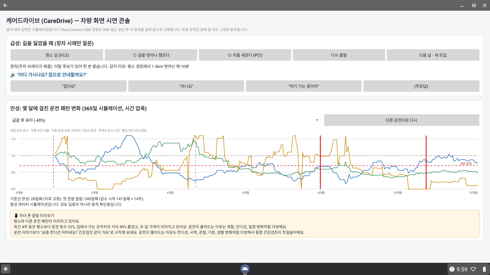

# 케어드라이브 (CareDrive)

> 부모님의 운전을 감시하지 않고, 정기 검사 사이에 크게 달라진 운전 패턴을 가족이 놓치지 않게 해 검진으로 이어지게 돕는 차량용 가족 안심 앱.
> 부모 차량 앱은 유료(월 3,900원, Pleos App Market), 자녀 모바일 앱은 무료다. 부모는 차량에서 한 번 수락한다. 현대자동차그룹 차량용 앱 개발 공모전 출품작.

## 전체 구성 (Final v1.2 · 와이어프레임 「04최종 와프」 구현)

| 위치 | 내용 |
| --- | --- |
| [`web/`](web) | **자녀 모바일 앱**(`/`, 화면 M-01 · C-010 ~ C-078), **차량 화면**(`/v`, V-000 ~ V-021), **서버 API**(`/api`), DB 스키마, 가상 계정·목업 데이터. Next.js + Neon Postgres. 실행·시연 순서는 [web/README.md](web/README.md) |
| [`app/`](app) | **차량용 Android 앱**. `VehicleActivity`가 차량 화면을 WebView로 띄우고, 음성(TTS·STT)·내비·이탈 감지(`core/Route.kt`)를 브리지로 연결한다. 앱 목록의 "케어드라이브 알고리즘 콘솔"은 아래에서 설명하는 판정 로직 시연 콘솔이다 |
| [`reference/`](reference) | 판정 규칙을 정할 때 쓴 Python 실험 |

차량 화면 주소는 `app/src/main/res/values/strings.xml`의 `web_url`이다.



## 무엇을 하나

| 채널 | 동작 |
| --- | --- |
| **만성** (몇 달에 걸친 변화) | 운전 횟수·야간 주행 비율·이동 반경을 28일 롤링으로 집계해, 부모 본인의 기준선(수락 후 28일 이상·트립 20회 이상 시점의 값, 이후 고정) 대비 -30% 이하인 지표가 2개 이상이고 그 상태가 56일 중 49일 이상일 때만 자녀에게 요약 알림. 야간 운전을 거의 안 해 야간 지표를 못 쓰면 남은 2지표의 평균으로 판정한다. 단발성 감소는 기록만 한다. 알림에는 **종합 건강검진** 권유가 붙는다. |
| **급성** (길을 잃었을 때) | 지난 28일 평소 경로와 비교해 ① 최근 15분 중 1km 이상 벗어난 시간이 10분 이상 ② 재탐색 3회 이상 ③ 평소와 다른 길에서 3분 이상 맴돎 ④ 평소 가장 먼 곳보다 2km 이상 멀리 감 중 하나면 이탈 후보. **정차 시에만** "어디 가시나요? 집으로 안내할까요?"라고 묻는다. 수락하면 내비 목적지를 집으로 설정, 거절·목적지 발화는 정상 이동, 무응답·수락은 길 잃음 후보 1건. 서로 다른 날 후보가 30일 안에 2건이면 자녀 알림과 **치매안심센터 인지선별검사** 권유. 응답은 "집"이 들어가거나 "네·응"이면 수락, "아니·괜찮아"면 거절, 다른 장소면 목적지 발화로 분류한다. |

앱은 치매·인지저하를 진단하지 않는다. 운전 감소는 시력·관절·우울·생활 변화로도 생기고 선행연구에서 정상군도 같은 속도로 줄었기 때문에, 만성 알림은 건강검진으로만 연결한다. 익숙한 길에서 반복해 헤매는 것은 알츠하이머 초기 경고 신호로 꼽히므로 급성 알림만 치매안심센터로 연결한다.

기획서: [docs/기획서.md](docs/기획서.md) (문제 정의, MVP 범위, 플로우와 예외 처리, 화면 정의, 수용 기준, KPI, 알고리즘 설계 기록과 한계)

접수양식 02장에 제출한 본문: [docs/접수양식_02장.md](docs/접수양식_02장.md)

<!-- PROTOTYPE_VIDEO -->

## APK와 실행 방법

- **APK 위치:** [`apk/`](apk) (`아크크_케어드라이브_release.apk`, release 서명)
- 설치: `adb install -r apk/<파일명>.apk`. 앱 목록에 아이콘이 둘 생긴다.
  - **케어드라이브**: 차량 앱 본체. 차량 화면(V-000 ~ V-021, 와이어프레임 「04최종 와프」 그대로)을 띄운다. **인터넷이 필요하다**(서버 `https://caredrive-beta.vercel.app`). 가로 화면 에뮬레이터에서 실행한다.
  - **케어드라이브 알고리즘 콘솔**: 판정 로직 시연용(아래 설명).
- **심사 순서**: 차량 앱을 열면 연결 코드 6자리가 뜬다 → 휴대폰 브라우저에서 `https://caredrive-beta.vercel.app`(자녀 앱)을 열어 `010-9876-5432` / 인증번호 `123456`으로 로그인하고 그 코드를 입력 → 차량에서 "동의하고 연결하기". 오른쪽 아래 **시연** 패널로 변속(P·D), 길 이탈, 시동 끄기, 다음 날, 평소 4주·감소 12주를 넣어 급성·만성 알림을 만든다. 가상 계정과 시연 순서는 [web/README.md](web/README.md).
- **알고리즘 콘솔**은 아래와 같다.
  - 위쪽 "급성": "① 길을 벗어나 맴돈다"를 누르면 합성 궤적(지난 28일 평소 경로 + 오늘 궤적)을 **실제 이탈 감지기**에 넣어 판정한다. "② 차를 세운다(P단)" → 음성 질문에 응답(수락 / 거절 / 목적지 발화 / 무응답). "다음 날 · 새 트립"으로 날을 넘겨 후보가 쌓이면 자녀 알림 미리보기가 뜬다. "평소 길 (비교)"는 같은 감지기가 평소 길을 후보로 잡지 않는 것을 보여준다.
  - 아래 "만성": 시나리오(정상 / 완만한 감소 / 급감 / 횟수만 감소)를 고르면 365일 합성 주행 데이터에 판정 로직이 돌고, 기준선 대비 지표 3개와 알림이 울린 날이 차트에 그려진다. 자녀 알림 문구는 문구 생성기가 줄어든 지표와 비율로 만든다.

### 시연 콘솔의 범위 (중요)

센서·내비 입력은 **시뮬레이션**이다. 판정 로직(`app/src/main/java/com/caredrive/app/core/`)은 실제 앱 코드 그대로 동작하지만, Pleos Connect SDK(Vehicle, FusedLocation, NaviHelper, TextToSpeech, SpeechToText)는 공개된 개발 문서 범위에서 Pleos Connect 에뮬레이터에 연동해 시뮬레이션 입력을 실제 값으로 교체할 계획이다. **이 APK에는 아직 Pleos SDK 연동이 없다**(차량 앱 본체의 음성 출력은 Android TTS, 집 안내는 표준 내비 인텐트로 대신한다. **음성 인식은 기기 안에서만 도는 인식기만 쓰며 음성을 외부 인식 서비스로 보내지 않는다.** 그런 인식기가 없는 환경에서는 화면 버튼으로 답한다). 원시 신호 → 트립 → 하루 요약 → 판정 파이프라인은 구현돼 있어 SDK 값만 `ChronicPipeline.onSample()`에 넣으면 된다.

## 알고리즘 구성 (`app/src/main/java/com/caredrive/app/core/`)

| 파일 | 역할 |
| --- | --- |
| `Recorder.kt` | 차량 신호 → 트립 분할(주차 브레이크·P단 + 정지 5분), 야간(전조등), 이동 거리, 집 추정, 집 기준 이동 반경. 기록 전용 탐색 지표(급제동, 급조향, 안전 경고, 방향지시등 사용률, 고속도로 비율, 일별 주행거리 변동성, 목적지 수) |
| `Store.kt` | 하루 요약만 저장(원시 로그 저장 안 함), 보존 400일, 고정 기준선은 따로 저장, 평소 경로는 격자 칸으로 28일만, 동의 철회 시 전부 삭제 |
| `Pipeline.kt` | 전체 흐름. 앱 재시작 시 복원, 차량 교체(차량 ID 변경) 시 재학습, 검진 완료 시 재학습 |
| `Chronic.kt` | 만성 판정(기준선 고정, 56일 중 49일, 쿨다운 12주, 제외일 동결, 야간 지표 없을 때 2지표 평균, 야간 비율 축소 추정). 계절 보정은 구현돼 있으나 기본값은 끔(아래 결과) |
| `Route.kt` | 급성 이탈 감지(접두 구간 정렬, 진행 방향 엔트로피, 평소 경로 이탈 누적, 평소 반경 밖) |
| `Acute.kt` | 정차 시에만 질문, 하루·트립당 1회, 음성 응답 분류, 30일 2건 알림 |
| `OtherDriver.kt` | 타인 운전 필터(트립 조작 특징의 마할라노비스 거리, 학습 트립을 두 무리로 나눠 부모 무리를 찾음) |
| `Alerts.kt` | 자녀 알림·월간 요약·대화 코칭 문구(템플릿, 진단 표현 없음, 첫 해 겨울 계절 완충 문구). 만성은 건강검진, 급성은 치매안심센터로 연결 |
| `Cusum.kt` | 부록 D 대안(중앙값·MAD + 그룹 CUSUM). 비교용이며 앱 기본값 아님 |
| `Sim.kt`, `AcuteSim.kt`, `Drive.kt` | 합성 데이터 생성기(만성 365일, 급성 궤적, 1초 간격 차량 신호) |

## 테스트 환경

| 항목 | 값 |
| --- | --- |
| 목표 플랫폼 | Pleos Connect Emulator **2.1.0** (Android Automotive, API 34), minSdk 28, targetSdk 34 |
| 개발 도구 | Android Studio, AGP 9.5.1, Gradle 9.6.0, Kotlin, JDK 17 |
| **실제 구동 확인** | Android Emulator `Medium Desktop` (Android 14, API 34, **3840×2160** 가로 화면). 차량 앱 본체는 설치·실행, 서버 연결, 연결 코드 발급 화면(V-000)까지 에뮬레이터에서 확인했다. 급성 질문 → 집 안내, 만성 알림 흐름은 웹(시연 패널)과 알고리즘 콘솔에서 확인했다 |
| **화면 규격** | 차량 화면은 **1280×720(16:9)** 기준으로 설계하고, 창 크기에 비율을 유지한 채 맞춘다(3840×2160에서 확인). Pleos Connect Emulator의 실제 화면 규격은 아직 확인하지 못해 1280×720은 가정이다 |
| **아직 확인하지 못한 것** | Pleos Connect Emulator 2.1.0 이미지에서의 구동과 그 화면 규격, 에뮬레이터에서의 실제 음성 인식(마이크, 기기 안 인식기가 있는 환경). 이미지 설치 후 확인해 이 표를 갱신한다 |
| 서버 | 자체 서버 소스는 [`web/`](web)에 있다(Next.js + Postgres). 비밀값(DB 접속 정보 등)은 저장소에 없고 배포 환경변수로만 둔다 |

## 빌드와 테스트

```bash
./gradlew :app:testDebugUnitTest      # 유닛 테스트 39개
./gradlew :app:assembleRelease        # 키를 안 주면 디버그 키로 서명된다
./gradlew :app:assembleRelease -PkeystoreFile=<jks 경로> -PkeystorePass=<비밀번호>   # 릴리스 키 (별칭: caredrive)
```

- **프로젝트 경로에 한글이 있으면 AGP가 빌드를 막는다.** ASCII 경로로 복사해서 빌드한다.
- 테스트 구성: 만성 판정 8, 급성 질문·응답 분류·누적 6, 일별 기록·저장·파이프라인·필터 11, 급성 이탈 감지 5, 알림 문구·연결처 5, 시뮬레이션 비교 4(타인 운전, 계절, CUSUM, 감소 크기별 탐지). 시뮬레이션 테스트는 결과를 출력하고 회귀 방지용 느슨한 기준만 건다.

## 합성 데이터 검증 결과

실제 치매 라벨 데이터는 구할 수 없어 합성 데이터로 동작과 오경보 통제를 확인했다. **성능 입증이 아니라 동작 확인이고, 노이즈 크기와 시나리오는 가정이다**(휴식기 7~21일 연 1.5회, 주별·월별 편차, 격자형 도로).

### 만성 (앱 코드, 현실 노이즈, 300명, 1년)

| 시나리오 | 결과 |
| --- | --- |
| 정상 유지 | 오경보 연 0.04회 |
| 겨울 완만 감소 | 오경보 연 0.16회 |
| 완만한 감소 (주 3%) | 탐지 98%, 중앙 지연 19주 |
| 급감 -40% 유지 | 탐지 85%, 중앙 지연 10주 |
| 운전 횟수만 -40% (지표 1개) | **27%가 알림을 받음** (의도는 '알리지 않음'. 야간 비율 노이즈 때문이며 축소 추정으로 32%에서 줄였다) |

### 감소 크기별 탐지 (앱 코드, 300명, 3지표가 같은 비율로 감소한 뒤 32주 안)

| 감소 | 0% | −10% | −15% | −20% | −25% | −30% | −40% |
| --- | --- | --- | --- | --- | --- | --- | --- |
| 알림 비율 | 2% | 8% | 17% | 30% | 41% | 61% | 85% |
| 중앙 지연 | — | 17주 | 18주 | 14주 | 13주 | 13주 | 10주 |

선행연구의 인지저하 집단과 정상 집단의 차이(약 10~15%) 수준은 대부분 놓친다. 정상군도 같은 속도로 운전이 줄어(Chen 2025) 작은 감소를 잡으면 오경보가 되므로 의도한 선택이다. 그래서 만성 채널은 인지저하 조기 탐지가 아니라 검사 사이의 큰 변화를 잡는 안전망이다.

### 급성 (100회씩)

| 장면 | 이탈 후보로 잡힌 비율 | 중앙 시간 |
| --- | --- | --- |
| 평소 목적지 · 평소 경로 | 0% | - |
| 평소 목적지 · 다른 길 | 3% | 11.6분 |
| 처음 가는 목적지 | 9% (정차 질문에서 목적지를 말하면 정상 이동으로 처리) | 13.3분 |
| 한 번 길 잘못 듦 (3분 뒤 복귀) | 9% | 4.7분 |
| 길 잃고 맴돎 | 99% | 이탈 시작 후 10.3분 |
| 길 잃고 엉뚱한 방향으로 직진 | 100% | 이탈 시작 후 12.0분 |

### 고친 것과 고치지 않은 것 (각각 두 번 이상 검증)

| 항목 | 결과 | 결정 |
| --- | --- | --- |
| 연속 56일 → 56일 중 49일 | 급감 탐지 70%대 → 85~89% | 채택 |
| 야간 운전을 안 하는 운전자 | 급감 탐지 56~66% → 83~86% (2지표 평균 판정) | 채택 |
| 야간 비율 축소 추정(의사 표본 5트립) | 운전 횟수만 −40%일 때 알림 32% → 27% | 채택 |
| 짧은 우회 오탐 | 44% → 9% (맴돎 3분 지속 조건) | 채택 |
| 타인 운전 40% 혼입 | 필터 없음 25% → 습관 차이 3σ 68%, 2σ 46%, 1σ 이하 효과 없음(필터가 스스로 꺼짐) | 채택. 습관이 비슷한 가족은 못 거른다 |
| 계절 보정(1년 학습) | 2년째 겨울 오경보 14% → 12%, 급감 탐지 98% → 95% | 기본값 끔. 1년치로는 계절당 표본이 한 번뿐 |
| 그룹 CUSUM(부록 D) | 시작값(k=0.5, h=3)은 정상 오경보 63%. 오경보를 10%로 낮추면 급감 탐지 72% (규칙은 오경보 4%에서 88%) | 기각. 규칙 유지 |
| 임계값 (-30%, 53/56일) | 오경보 5% → 3%, 노화 오경보 17% → 12%, 급감 탐지 89% → 84% | 보류. 맞바꾸는 관계라 현재 값 유지 |
| 정상 노화 3년 | 연 -10%: 3년 안에 53%, 연 -20%: 100%가 알림. 기준선이 천천히 따라오게 해도 50% | 원리상 해결 불가. 검진 완료 시 재학습과 점검 권유 문구로 대응 |

만성 판정 규칙을 정할 때 돌린 실험 표(연속 56일 대 56일 중 49일, 운전자 유형별)는 [reference/README.md](reference/README.md).

## 저장소 구조

```
app/        Android 앱 (Kotlin). core/ 에 알고리즘 전체와 시뮬레이터
apk/        release APK
docs/       기획서, 시연 화면
reference/  만성 판정 규칙의 Python 기준 구현과 규칙 결정 실험 (급성 감지·응답 분류·알림 문구는 app/ 에만 있다)
```

## 알려진 한계

- 선행연구의 AUC는 집단 분류 수치이며 본 앱의 민감도·특이도가 아니다. 개인의 운전 감소로 인지저하를 가려낼 근거는 없다(Chen 2025에서 감소 기울기가 두 집단 거의 같음).
- 만성 규칙은 −10~15% 수준의 작은 감소를 대부분 놓친다(위 표).
- 급성 감지와 음성 응답 분류는 합성 데이터로만 확인했다. 무응답에는 못 들음·소음 같은 다른 원인도 있다.
- **정상 노화와 병적 감소를 구분할 수 없다.** 몇 년에 걸친 정상적인 운전 감소도 결국 알림 조건에 닿는다.
- 타인 운전 필터는 부모가 트립의 과반을 운전하고, 다른 가족의 운전 습관이 뚜렷이 다를 때만 효과가 있다.
- 급성 시뮬레이션은 격자형 도로와 단순한 궤적이다. 실제 도로망·GPS 끊김·지하 주차장은 반영하지 않았다.
- 임계값은 시작값이고, 정할 때 쓴 노이즈는 가정이다.
- 위치 데이터 서비스는 관련 법령(위치정보법, 개인정보보호법의 민감정보) 적용 여부를 확인해야 한다.
