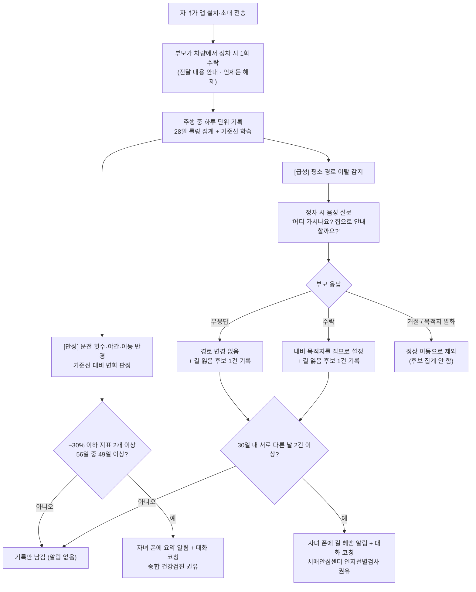

# 케어드라이브(CareDrive) — 현대자동차그룹 차량용 앱 개발 공모전 최종 기획안 (통합본)

> 버전: Final v1.2 (통합본) · 상태: 팀 확정안 + 와이어프레임(v3) 완전 정합 및 과금·트립 체계 전면 개편 · 접수 마감: **2026-11-15(일) 23:59**
> 팀 최종안의 상세 구조와 [보강] 섹션을 온전히 유지하며, 최종 와이어프레임(Figma)과 불일치했던 **과금 체계(차량 앱 유료 구독 / 모바일 완전 무료)**, **트립 판정 기준(시동을 끈 시점 기준)**, **UI 표기 지표(야간 운전 횟수, 활동 반경)** 및 **안심귀가 플로우**를 전면 반영·정합화했다. 고친 섹션은 제목에 **[수정]**으로 표시했다.

**한 문장 정의**
케어드라이브(CareDrive)는 자녀가 설치하고 부모가 차량에서 한 번 수락하면, 부모의 평소 운전 습관을 학습해 크게 달라진 점을 자녀에게 요약해 전달하는 가족 안심 앱이다.

### 구현 현황 (2026-11-15 제출 시점)

- **구현·동작 확인**: 자녀 모바일 앱 화면(M-01 ~ C-078), 차량 화면(V-000 ~ V-021), 서버·DB, 만성·급성 판정 엔진, 가상 계정·목업 데이터. 코드는 이 저장소의 `web/`(앱·서버)과 `app/`(Kotlin 판정 엔진·차량 앱)에 있다.
- **시뮬레이션**: 주행 신호(변속·경로 이탈·주행 요약)는 시연 패널로 넣는다. Pleos SDK(Vehicle·FusedLocation·NaviHelper·TextToSpeech·SpeechToText) 연동은 Pleos Connect 에뮬레이터에서 진행할 계획이다.
- **미확인**: Pleos Connect Emulator에서의 구동과 화면 규격, 에뮬레이터의 실제 음성 인식. 음성 인식은 기기 안 인식기만 쓰고 외부 서비스로 보내지 않는다.
- **구현하지 않은 것**: QR 스캔 연결, 푸시 알림(앱 안 알림 목록으로 대체), 검진 기관 실데이터.

---

## 0. 한눈에 보기 [수정]

| 하는 일 | 하지 않는 일 |
| --- | --- |
| 부모 본인의 평소 운전과 비교해 크게, 오래 이어지는 변화를 자녀에게 요약 전달 | 치매·인지저하 진단, 위험 점수 제시 |
| 정차 시 "집으로 안내할까요?" 제안과 차량 내비 귀가 안내 | 실시간 위치·상태 중계, 경로 몰래 변경 |
| 신호별로 다른 검진 안내: 활동 감소 → 종합 건강검진, 익숙한 길에서 반복된 헤맴 → 치매안심센터 인지선별검사 | 운전 제한·차단, 면허 반납 권유 |
| 부모가 공유 내용을 차에서 확인하고 언제든 멈추거나 삭제 | 마케팅·제3자 제공 |
| 차량 인포테인먼트 앱 유료 구독(월 3,900원 / 첫 달 무료) + 자녀 모바일 앱 100% 완전 무료(무제한 연동) | 자녀 앱에 결제 장벽을 두어 가족 연동을 저해하는 구조 |

**최신 개편 내역 (와이어프레임 정합 및 과금·트립 체계 전면 개편, Final v1.2, 2026-11-15)**

| 개편 항목 | 이유 및 반영 내용 | 위치 |
| --- | --- | --- |
| **과금 체계 전면 개편** | **차량 앱 유료 구독(월 3,900원, 첫 달 무료 체험) + 자녀 모바일 앱 100% 완전 무료**. 자녀 결제 저항을 원천 제거해 연동율을 극대화하고 차량 인포테인먼트 유료 생태계에 기여 (와이어 C-075/M-09 정합) | 3, 6, 8.2, 11, 14, 15, 17 |
| **트립 판정 기준 수정** | **5분 정차 분할 룰 폐기 → 시동 ON부터 시동 OFF(시동을 끈 시점)까지를 1개 트립으로 확정**. 시동 끈 시점 기준으로 일별 데이터 요약 정리 (와이어 UI 로직 정합) | 4, 7.2, 9, 10, 부록 A |
| **UI 지표 표기 정합성** | 알고리즘상 전조등 점등 시간 비율 및 평균 거리를 **UI 화면에는 「야간 운전 횟수 (월 N회)」 및 「활동 반경 (N km)」으로 직관적 표기** | 4, 8, 10, 부록 A |
| **안심귀가 및 이상 탐지 플로우** | 만성 알림(건강검진 가이드 M-06A/C-040A) vs 급성 길 헤맴(30일 2건 누적 시 치매안심센터 선별검사 M-06B/C-040B) 라우팅 확정 | 4, 7, 8, 9, 12 |

**이전 통합본에서 고친 것 (논리 재검토, Final v1.1, 2026-11-15)**

| 고친 것 | 이유 | 위치 |
| --- | --- | --- |
| 만성 알림은 건강검진, 길 헤맴 알림만 치매안심센터로 연결을 분리 | "앱은 원인을 알 수 없어서 종합 점검을 권한다"고 해놓고 치매안심센터로 보내던 모순 (와이어 C-031 → C-040) | 4, 7, 8, 9, 12 |
| 장시간 배회 즉시 알림 삭제 → 30일 2건 길 헤맴 알림 | 급성 규칙(서로 다른 날 2건)·"실시간 위치를 보내지 않아요"와 충돌, 구현되지 않음 | 4, 6, 7.4, 8, 20 |
| 문제 정의를 "검사 사이의 공백"으로 | "인지 검사로는 운전 역량을 모른다"고 비판한 뒤 인지 검사로 보내던 순환 논리 | 2 |
| Chen 2025 해석 정정 | 운전 감소 기울기가 MCI군과 정상군이 거의 같음(−0.50 vs −0.52) → 개인 감소로 판별 불가 | 2, 10, 부록 H |
| 감소 크기별 시뮬레이션 추가 | −10~15% 감소는 8~17%만 잡힘 → "조기 탐지기"가 아니라 "큰 변화 안전망" | 10, 17 |
| 수치 정정 | 급감 탐지 88% → 85%, 완만한 감소 99% → 98%, 테스트 36 → 39개, Bayat 2021 AUC → F1, "8주 중 7주" → "56일 중 49일" | 10, 18, 19, 부록 |
| 단계 규칙표 겹침 정정 | "정상 0~1개 / 기록 1개 이상"이 겹침 | 10 |
| 전조등 야간 판정을 장점에서 한계 포함으로 | 터널·흐린 날 점등은 야간 비율을 오염시킴 | 5 |
| 음성 응답 분류 규칙 명시 | "집이요"가 수락인지 목적지 발화인지 규칙이 없었음 | 7.4, 10 |

**팀 최종안에서 보강한 것 (Final v1.0)**

| 보강 항목 | 위치 |
| --- | --- |
| 문제 진술과 사실·가설 구분 | 2.1 |
| 차량 특화성 논리 (휴대폰 대비 비교표) | 5 |
| MVP 범위 (P0/P1/P2/Won't)와 2차 PT 완료 기준 | 6 |
| 전체 플로우 6개와 예외 처리 | 7 |
| 차량·자녀 화면 정의와 상태(빈·로딩·오류) | 8 |
| P0 기능 요구사항과 수용 기준 | 9 |
| KPI 정의와 계산식 | 15 |
| 검증 실험 설계 | 16 |
| 리스크와 예상 심사 질문 | 17 |
| 접수양식 1–8번 초안 | 19 |
| 남은 의사결정 | 20 |

---

## 1. 앱 개요 [수정]

- **한 줄 소개**: 부모님의 운전을 감시하지 않고, 평소와 크게 달라진 운전 패턴을 가족이 놓치지 않게 돕는 차량용 앱
- **핵심 가치**: 정기 검사 사이에 생긴 큰 변화를 가족이 놓치지 않게 하고, 갈등 없이 검진으로 이어지게 한다. 활동이 크게 줄면 건강검진으로, 익숙한 길에서 반복해 헤매면 치매안심센터 선별검사로 연결한다
- **사용 환경 및 과금**: Pleos Connect 기반 차량 인포테인먼트 앱(유료 구독, 월 3,900원 / 첫 달 무료)과 자녀 스마트폰 앱(100% 완전 무료 다운로드 및 연동)
- **이름**: 케어드라이브는 가칭. 상표·기존 서비스명 중복 확인 필요

---

## 2. 문제 정의 [수정]

**고령 운전자는 대부분 계속 운전하지만, 3년마다 받는 검사 사이에 생기는 변화를 확인할 장치가 없고, 가족이 변화를 눈치채도 말을 꺼내기 어렵다.**

- **계속 운전하는 고령자**: 65세 이상 운전면허 소지자는 2024년 약 517만 명이고, 면허 반납률은 2%대에 머문다(14장 출처). 고령 운전자가 늘면서 65세 이상 운전자가 가해자인 교통사고도 2020년 3만 1,072건에서 2024년 4만 2,369건으로 늘었다(도로교통공단 통계, 서울시 교통통계 게재본). 이 수치는 운전자 수 증가 효과가 섞인 건수라 개인의 위험이 커졌다는 근거로 쓰지 않고, 문제의 규모를 보여주는 배경으로만 쓴다.
- **검사 사이의 공백**: 75세 이상은 3년마다 정기 적성검사를 받고 치매 선별검사(CIST) 결과에 따라 수시검사를 추가한다. 그 사이 최대 3년 동안은 변화를 확인할 장치가 없다. 정부는 2026년부터 실차·VR 기반 운전능력 진단 시스템을 시범 운영하고 2027년 조건부 면허 연계를 검토한다(브라보마이라이프). 케어드라이브는 이 검사를 대신하지 않는다. 일상 운전에서 큰 변화가 보이면 다음 검사를 기다리지 않고 검진을 받도록 이끄는 역할만 한다.
- **운전 감소만으로는 치매를 가려낼 수 없다**: 미국 연구(Chen 2025, 298명: 경도인지장애(MCI) 56명·정상 242명, 최대 40개월)에서 중간 트립 거리·과속·이동 엔트로피·최대 거리로 MCI를 구분한 AUC는 0.82, 인구통계·APOE·인지점수를 더하면 0.87이었다. 그러나 시간에 따른 감소 기울기는 두 집단이 거의 같았다(월 트립 수 MCI −0.50, 정상 −0.52, 야간 트립 −0.33 vs −0.34). 운전이 줄었다는 개인 변화만으로는 MCI를 구분할 수 없다는 뜻이다. 또 이 AUC는 본 앱이 쓰지 않는 지표(과속, 최대 거리)를 포함한 집단 분류 결과라 본 앱의 성능 근거가 아니다.
- **길 헤맴은 인지 쪽 신호다**: 익숙한 곳에서 길을 잃거나 익숙한 장소로 운전해 가는 데 어려움을 겪는 것은 미국 국립노화연구소(NIA)와 알츠하이머협회가 꼽는 알츠하이머 초기 경고 신호다. 진단은 아니지만 인지 기능 확인을 권할 근거가 된다.
- **그래서 두 신호를 다르게 연결한다**: 활동 감소(만성)는 시력·관절·우울·생활 변화로도 생기므로 **건강검진**으로, 익숙한 길에서 반복해 헤매는 것(급성)은 **치매안심센터 인지선별검사**로 연결한다.
- **가족의 고민**: 자녀는 부모의 운전이 걱정되어도 면허를 빼앗을 수 있다는 부담 때문에 운전 이야기를 꺼내기 힘들고, 부모도 방어적이 된다. *(사용자 인터뷰·설문으로 보강 예정 — 최소 5–10명 확보 권장)*

### 2.1 문제 진술과 근거 구분 [보강·수정]

> 고령 부모가 운전을 계속하는 상황에서, 떨어져 사는 자녀는 부모에게 큰 변화가 생기면 알고 자연스럽게 검진을 권하고 싶지만, 매일의 운전을 볼 수 없고 부모도 자신의 변화를 느끼기 어렵다. 현재는 전화·동승·위치 공유로 확인하지만, 오래 이어지는 변화는 보이지 않고 운전 이야기는 면허 반납 갈등으로 번지기 쉽다.

| 구분 | 내용 | 상태 |
| --- | --- | --- |
| 사실 | 고령 운전자 사고 건수 증가(운전자 수 증가 효과 포함), 면허 반납률 2%대 | 통계·보도로 확인 |
| 사실 | 인지저하 집단은 운전 횟수·야간·이동 범위가 정상 집단보다 조금 낮다(효과 크기 작음). 단 개인의 감소 속도는 정상군과 거의 같아 개인 판별 근거는 아니다 | 선행연구, 부록 G2·H |
| 사실 | 생활 반경 축소는 노쇠·우울·인지저하 위험 증가와 함께 나타난다 | James 2011, MrOS 2023 |
| 사실 | 익숙한 곳에서 길을 잃는 것은 알츠하이머 초기 경고 신호로 꼽힌다 | NIA, 알츠하이머협회 |
| 가설 H1 | 자녀는 부모 운전 걱정을 말하지 못하고 있다 | 인터뷰 필요 |
| 가설 H2 | 차량 소유주/가족은 차량 앱 월 구독료(3,900원) 지불 의향이 있고, 자녀 무료 연동 시 설치 전환율이 극대화된다 | 인터뷰·가격 테스트 필요 |
| 가설 H3 | 부모는 투명한 조건이면 수락한다 | 수락 문구 테스트 필요 |
| 가설 H4 | 차량 앱이 주행 내내 위치를 기록할 수 있다 | 에뮬레이터 검증 필요 (최우선 기술 위험) |

---

## 3. 타깃 고객과 사용 구조 [수정]

**부모 차량 인포테인먼트 앱은 Pleos App Market을 통한 유료 구독으로 운영되며, 자녀의 모바일 스마트폰 앱 및 연동 시스템은 완전 무료(100% Free)로 제공된다.** 고령 부모의 안전 운전을 돕는 차량 인포테인먼트 생태계의 유료 가치를 확립하면서도, 자녀의 결제 장벽을 원천 제거하여 가족 연동 성공률을 극대화하고 동의 없는 기록을 철저히 배제하는 구조다.

| 역할 | 사용자 | 수행 업무 및 권한 | 과금 모델 |
| --- | --- | --- | --- |
| **서비스 호스트** | 부모 (차량 운전자) | 차량 인포테인먼트 디스플레이에서 앱 구동 및 정차 중 1회 수락, 언제든 연결 해제 및 기록 삭제 권한 보유 | **차량 앱 유료 구독** (월 3,900원 / 첫 달 무료 체험) |
| **안심 수신자** | 자녀 (보호자 가족) | 모바일 앱을 무료 다운로드하고 차량의 6자리 코드로 연동, 월간 안심 요약 리포트 수신 | **100% 완전 무료** (무료 다운로드 및 무제한 연동) |

**수락 화면 문구 (차량 디스플레이 V-02)**: *"평소 운전 패턴(횟수·야간·활동 반경)이 달라지면 자녀분께 요약해서 알려드려요. 실시간 위치는 보내지 않아요. 언제든 끌 수 있어요."*

- 무엇을 수집해 누구에게 전달하는지 숨기지 않는다. 진단·치매 같은 표현만 부모 화면에서 쓰지 않는다.
- **부모 투명성**: 부모는 차량 화면에서 "이번 달 자녀에게 공유된 내용"을 언제든 볼 수 있다.
- **동의 방식**: 공유를 시작·확대하는 동의는 정차 중 화면 버튼으로만 확정한다(동승자·라디오 음성 오인식 방지, Pleos App Market도 버튼 동의만 인정). 공유를 멈추는 요청은 음성도 허용하고, 연결 해제·기록 삭제는 정차 중 화면으로만 한다.

---

## 4. 핵심 기능 [수정]

**핵심은 "운전 습관을 기준선과 비교해 큰 변화를 읽고, 신호에 맞는 검진으로 자녀를 안내하는 것"이다.**

1. **기록과 기준선 학습 (시동을 끈 시점 기준)**: 시동 ON부터 시동 OFF(시동을 끈 시점)까지의 1회 주행을 온전한 1개 트립으로 기록한다. 시동을 끄는 시점에 데이터가 일별 요약으로 정리되며, 수락 후 28일 이상이고 트립이 20회 이상 모이면 그 시점의 값을 본인의 기준선으로 삼는다. 개인별 기준이라 다른 사람과 비교하지 않는다.
2. **변화 감지 (만성 - 와이어프레임 지표 체계)**: 28일 롤링 지표 3개(운전 횟수, 야간 운전 횟수, 활동 반경)가 기준선보다 30% 넘게 줄어든 상태가 2개 이상, 두 달 가까이(56일 중 49일 이상) 이어질 때만 알린다. 단발성 감소는 기록만 한다.
3. **제안형 귀가 안내 (급성)**: 평소 경로를 벗어나 헤매면 **정차 시에만** 음성으로 "어디 가시나요? 집으로 안내할까요?"라고 묻는다. 수락하면 차량 내비게이션 목적지를 집으로 설정하고(경로 옵션 '편안한 길'은 설계 가설), 거절하거나 무응답이면 경로는 바꾸지 않는다. 수락과 무응답은 길 잃음 후보로 기록한다.
4. **자녀 요약 알림**: 실시간 위치나 현재 상태가 아니라 지나간 변화의 요약만 보낸다. 즉시 알림은 하지 않는다. 길 헤맴도 30일 안에 서로 다른 날 2건이 쌓여야 알린다.
5. **대화 코칭 (신호별로 다른 연결)**: 앱은 진단하지 않고 권유만 한다.
   - 만성 알림(활동 감소): 운전 감소는 우울·고립·시력·관절·자발적 방어운전일 수도 있으므로 "요즘 컨디션 어떠세요? 건강검진 같이 가요"라는 대화 가이드와 **종합 건강검진**을 권한다.
   - 급성 알림(반복된 길 헤맴): "요즘 길 찾기 어떠세요?"라는 대화 가이드와 가까운 **치매안심센터 무료 인지선별검사**를 권한다.

---

## 5. 차량 특화성 [보강·수정]

**이 서비스는 주행·정차 맥락을 알고 있는 차량이어야만 제대로 동작하고, 모바일 앱으로는 대체하기 어렵다.**

- **운전 중 방해 금지**: 질문과 안내는 정차 시에만 화면과 짧은 음성으로 하고, 주행 중에는 조작을 요구하지 않는다.
- **차량 내비게이션과 직접 연동**: 수락 시 별도 앱 없이 차량 내비게이션 목적지를 바로 집으로 설정한다.
- **차량에서만 얻는 맥락**: 시동·주행·정차 상태, 전조등, 차량 위치로 부모가 조작하지 않아도 자동으로 기록된다.

**휴대폰 앱과 무엇이 다른가**

휴대폰도 백그라운드에서 운전을 자동 감지할 수 있고, 운전 횟수·이동 반경 같은 지표는 휴대폰 위치로도 계산된다. 차량 특화의 핵심은 "자동 기록"이 아니라 아래 세 가지다.

| 항목 | 휴대폰 앱 | 케어드라이브(차량) |
| --- | --- | --- |
| **누가 운전했나** | "차 안에 있다"까지만 알아, 부모가 자녀 차에 동승해도 운전으로 기록될 수 있음 | 부모 차의 주행만 기록. 다른 가족이 부모 차를 운전한 트립은 조작 패턴 필터로 일부 걸러냄(습관 차이가 클 때만, 부록 F) |
| **정차 판단** | 속도로 추정해 신호 대기와 구분이 어려움 | 주차 브레이크·P단으로 판단 → 신호 대기 중에는 질문하지 않음 |
| **도움 실행** | 별도 내비 앱을 열어야 함 | "응" 한마디로 차량 내비 목적지를 집으로 설정 |
| 야간 판단 | 시각·일몰로 추정 | 전조등 점등 기록. 터널·흐린 날 점등이 섞이므로 일몰 시각으로 보조 판정한다(부록 A) |
| 누락 | 휴대폰 미소지·배터리 절약·위치 끄기에 약함 | 시동과 함께 동작 |

> 정직한 한계: 만성 지표 자체는 휴대폰으로도 계산 가능하다. 그래서 발표에서는 "차량이어야 하는 이유"를 **운전자 귀속, 정차 맥락 보장, 내비 직접 실행**으로 설명하고, 급성 채널(정차 질문 + 귀가 안내)을 메인 시연으로 둔다.

---

## 6. MVP 범위 [보강·수정]

### 6.1 우선순위

| 우선순위 | 기능 | 근거 |
| --- | --- | --- |
| P0 | 초대·수락 (자녀 초대 → 차량 정차 중 버튼 수락 → 연결) | 모든 기록의 전제. 동의 없이는 시작하지 않음 |
| P0 | 기록 파이프라인 (시동 ON~OFF 기준 트립 확정, 일별 요약, 원시 데이터 폐기) | 만성 판정의 입력, 개인정보 최소 수집 |
| P0 | 기준선 학습 + 만성 판정(본문 규칙) + 시뮬레이션 주입 모드 | 핵심 가치, 시연에서 시간 압축 필요 |
| P0 | 급성 이탈 감지 + 정차 시 TTS 질문 + STT 응답 분류 + 귀가 안내(requestRoute) + 30일 2건 누적 | 메인 시연, 차량 특화성의 핵심 |
| P0 | 자녀 요약 알림 + 신호별 코칭 (만성 → 건강검진 가이드, 길 헤맴 → 인지 확인 가이드) | 결과를 맞는 행동으로 연결 |
| P0 | 부모 투명성 화면 + 공유 멈춤 + 연결 해제·기록 삭제 | 동의 구조의 신뢰, App Market 요건 |
| P1 | 월간 요약 "평소와 비슷해요", 여행·입원 기간 태그, 검진 완료 입력·재학습, "이 알림이 맞지 않아요" 피드백 | 오탐 완화와 지속 이용 |
| P1 | 타인 운전 필터, 차량 교체 시 재학습 | 데이터 품질 |
| P1 (제안) | 부모용 주차 후 한 줄 안내 ("이번 주도 평소처럼 다니셨어요") | 부모가 차 안에서 얻는 가치 보강. 팀 결정 필요 |
| P2 | 부모가 따로 동의한 경우의 장시간 배회 즉시 알림(검토), 그룹 CUSUM 대체, LLM 문장, 월간 리포트 고도화, 전년 동월 비교, 보험·지자체 연계 | 검증 후 확장 |
| Won't | 실시간 위치·상태 공유, 진단·위험 점수, 운전 제한·차단, 경로 몰래 변경, 마케팅 활용 | 설계 원칙·규제 |

### 6.2 2차 PT 완료 기준 (Definition of Done)

- 에뮬레이터에서 자녀 초대 → 차량 수락 → "기록 중" 표시까지 끊김 없이 동작한다
- 급성 시나리오가 실시간으로 동작한다 (이탈 → 정차 → 질문 → "집이요" → 내비 목적지 설정 → 후보 1건, 알림 없음 → 다른 날 두 번째 후보 → 자녀 길 헤맴 알림과 인지 확인 가이드)
- 만성 시나리오를 압축 재생해 기준선 → 감소 구간 → 자녀 요약 알림 → "왜 알림이 왔나요?" → 건강검진 가이드까지 보여준다
- 부모 투명성 화면과 연결 해제·삭제가 동작하고, 해제 즉시 자녀 화면이 바뀐다
- 네트워크 끊김, SDK 미지원, STT 인식 실패에서 앱이 멈추지 않고 안전하게 동작한다 (7장 예외)
- LLM 없이 템플릿 문장만으로 전체 시연이 가능하다

---

## 7. 전체 플로우와 예외 처리 [보강·수정]

### 7.0 전체 시나리오

### 7.1 플로우 1: 초대와 수락

1. 자녀가 자녀 앱 설치 → 휴대폰 번호 인증으로 가입
2. 부모 차량에 케어드라이브 차량 앱 설치 (설치 주체·방법은 결정 필요, 20장)
3. 차량 앱 첫 실행(정차 중) → 연결 코드(6자리) 표시 (QR 스캔은 향후 기능)
4. 자녀가 자녀 앱에서 코드 입력 → 초대 전송
5. 차량 화면에 "지수님(딸)이 연결을 요청했어요" + 수락 문구 → [수락할게요] [아니요] [모르는 사람이에요]
6. 수락 → 기록 시작, 자녀 앱에 "연결됐어요. 평소 운전을 배우는 중이에요" 표시

| 예외 상황 | 처리 |
| --- | --- |
| 주행 중 초대가 도착 | 화면에 띄우지 않고 대기, 다음 정차(주차 브레이크·P단) 때 표시 |
| 연결 코드 만료 (가정: 10분) | 자녀 앱 "코드가 만료됐어요. 차량 화면의 새 코드를 입력해 주세요" |
| 잘못된 코드 | "코드를 다시 확인해 주세요", 5회 실패 시 10분 입력 제한 (가정값) |
| 부모가 [아니요] | 자녀 앱 "연결이 수락되지 않았어요". 이유는 표시하지 않음. 재초대 가능 |
| 부모가 [모르는 사람이에요] | 거절 + 코드 재발급 + 같은 번호 요청 24시간 차단. 자녀 화면 문구는 [아니요]와 동일 |
| 부모 무응답 (가정: 5분) | 요청 만료, 자녀 앱 "연결 요청 시간이 지났어요" |
| 이미 연결된 차량 | 추가 자녀 연결 허용 여부는 결정 필요(제안: 최대 2명, 부모 화면에 모든 연결 목록 표시) |
| 네트워크 끊김 | "연결이 불안정해요. 잠시 후 다시 시도해 주세요", 수락은 서버 확인 후에만 완료 |
| 필수 SDK·권한 미지원 차량 | 수락 전에 "이 차량에서는 일부 기능을 쓸 수 없어요"와 가능한 기능 목록을 먼저 보여줌 (isSupported 확인) |

### 7.2 플로우 2: 기록과 기준선 학습

1. 시동·주행 감지 → 트립 시작, 시동 OFF(시동을 끈 시점) 감지 시 트립 종료 및 확정 (와이어프레임 기준 일치)
2. 트립 종료(시동 OFF) 시 차량 안에서 일별 요약 갱신, 원시 위치·센서 로그 즉시 폐기
3. 서버에는 일별 요약 지표와 이벤트 여부만 동기화
4. 28일 이상 + 트립 20회 이상이면 기준선 완성 → 자녀 앱 "평소 운전을 다 배웠어요"

| 예외 상황 | 처리 |
| --- | --- |
| 운행이 적어 기준선이 늦어짐 | 자녀 앱에 진행률 표시(예: 14/28일, 9/20회), "운행이 적으면 조금 더 걸려요" |
| 백그라운드 위치 기록 불가 | 양쪽 화면에 "지금은 기록이 멈춰 있어요" 표시, 위치 기반 지표(이동 반경·급성)는 끄고 나머지만 기록. 최우선 검증 항목 |
| 트립 중 앱 종료·차량 전원 차단 | 마지막 저장 시점까지만 인정, 불완전 트립은 표시하고 집계 가중치 낮춤 (가정) |
| 서버 동기화 실패 | 차량에 요약을 보관했다가 재전송, 중복 전송은 날짜 키로 무시 |
| 차량 교체 | 차량 ID 변경 감지 → 기준선 재학습, 자녀에게 안내 |
| 긴 미운행 (가정: 14일 0회) | 알림 없이 자녀 앱에 "최근 운행이 없어요" 표시만. 기간 태그 제안 |

### 7.3 플로우 3: 만성 변화 알림 [수정]

1. 28일 롤링 지표를 매일 갱신 → 단계 규칙(10장) 적용
2. 관찰 알림 조건 충족 → 자녀 폰에 요약 알림 1회
3. 자녀가 "왜 알림이 왔나요?"(C-031)에서 무엇이 달라졌는지, 가능한 원인(시력·체력·기분·기억력), 걱정하지 않아도 되는 경우를 확인한다. 위치는 보여주지 않는다
4. 다음 행동은 **건강검진 가이드(C-040A)**: 대화 예시 + 가까운 건강검진 기관. 원인을 알 수 없는 신호라 치매안심센터는 여기서 안내하지 않는다
5. 12주 쿨다운. 자녀가 "검진 완료" 입력 시 재학습
6. 부모 투명성 화면에 "이번 달 자녀에게 공유된 내용"으로 같은 문장이 기록됨

| 예외 상황 | 처리 |
| --- | --- |
| 쿨다운 중 다시 조건 충족 | 발송하지 않고 타임라인에만 기록 |
| 태그된 여행·입원 기간 | 계산에서 제외(누적 동결) |
| 첫 해 겨울·장마 | 문구에 "계절 영향일 수 있어요" 추가 |
| 야간 비율 기준선 5% 미만 | 야간 지표 제외, 남은 2개 지표 보완 규칙(10장) 적용 |
| 자녀 폰 알림 꺼짐 | 앱 아이콘 배지와 홈 카드로 표시 |
| 자녀가 "이 알림이 맞지 않아요" 선택 | 사유 선택(여행, 입원, 이사, 타인 운전, 기타) → 해당 기간 보정 + 오경보 KPI로 집계 |
| 부모가 공유를 멈춘 상태 | 알림 미발송. 자녀 앱에 "지금은 공유가 멈춰 있어요"(이유 미표시) |
| 같은 30일 안에 길 헤맴 알림도 있었음 | 두 알림은 따로 보낸다. 길 헤맴 알림 쪽에서 치매안심센터를 안내하므로 만성 알림 문구는 바꾸지 않는다 |

### 7.4 플로우 4: 급성 이탈과 귀가 안내 [수정]

1. 이탈 후보 감지. 지난 28일 평소 경로와 비교해 아래 넷 중 하나: ① 최근 15분 중 평소 경로에서 1km 이상 벗어난 시간 10분 이상 ② 한 트립에 재탐색 3회 이상 ③ 평소와 다른 길에서 같은 구역을 3분 이상 맴돎 ④ 평소 가장 먼 곳보다 2km 이상 더 멀리 감 (부록 E)
2. 다음 정차(주차 브레이크·P단)까지 대기. 신호 대기 중에는 묻지 않음
3. TTS "어디 가시나요? 집으로 안내할까요?" + 화면 버튼 [집으로 안내] [괜찮아요]
4. STT 응답 분류: "집"이 들어간 말과 "네·응·그래·좋아"는 수락, "아니·아뇨·괜찮아"는 거절, 그 밖의 장소는 목적지 발화, 말이 없으면 무응답
5. 수락 → requestRoute(집, routeOption=COMFORTABLE 또는 FREE 검토) → "집으로 안내를 시작할게요" + 후보 1건. 무응답 → 경로 변경 없이 후보 1건. 거절·목적지 발화 → 정상 이동
6. 30일 안에 서로 다른 날 후보가 2건이면 자녀에게 **길 헤맴 알림(C-052)** 1회 → **인지 확인 가이드(C-040B)**: 대화 예시 + 가까운 치매안심센터 무료 인지선별검사. 1건으로는 알리지 않는다

| 예외 상황 | 처리 |
| --- | --- |
| STT 인식 실패·잡음 | 1회 재질문("잘 못 들었어요. 집으로 안내할까요?") 후 무응답으로 처리. 화면 버튼은 계속 남김 |
| 무응답 타임아웃 (가정: 15초) | 경로 변경 없음 + 후보 1건 기록, 화면은 조용히 닫힘 |
| 집 미설정 | 야간 정차가 가장 많은 지점 사용. 그것도 없으면 질문을 "도움이 필요하세요?"로 바꾸고 경로는 설정하지 않음 |
| 내비 미탑재·내비 앱 상태 이상 | requestRoute 실패 시 "지금은 안내를 시작할 수 없어요" + 후보만 기록 |
| 하루 질문 상한(1회) 도달 | 질문하지 않고 이탈 상태만 기록 |
| 동승자가 대답 | 구분 불가. 수락의 결과가 "집 안내"라 안전 측면 문제는 작음. 한계로 명시 |
| 장시간 배회 (Final v1.0의 즉시 알림) | **MVP에서 제외.** 30일 2건 규칙과 "실시간 위치·상태를 보내지 않아요"와 충돌한다. 부모가 수락 때 따로 동의하는 P2 옵션으로 검토 (20장) |
| 주행 재개 중 질문 화면이 남아 있음 | 출발 감지 즉시 화면을 닫고 무응답 처리 |

### 7.5 플로우 5: 부모의 확인·멈춤·해제·삭제

| 동작 | 방법 | 결과 | 자녀 화면 |
| --- | --- | --- | --- |
| 공유 내용 확인 | 정차 중 화면 | 이번 달 공유된 문장·날짜 목록 | 변화 없음 |
| 공유 잠시 멈춤 | 음성("공유 멈춰줘") 또는 화면. 주행 중에도 가능 | 기록은 계속, 전송만 중단. 재개는 정차 중 화면 | "지금은 공유가 멈춰 있어요" |
| 연결 해제 | 정차 중 화면 + 확인 버튼 | 연결 종료, 서버의 요약 데이터 즉시 삭제 | "연결이 해제됐어요"(이유 미표시), 재초대 필요 |
| 기록 삭제 | 정차 중 화면 + 확인 버튼 | 차량·서버 기록 즉시 삭제, 기준선 초기화 | "기록이 초기화됐어요" |

- "공유 멈춤"을 가족에게 알리는 이유: 알림이 없는 걸 "괜찮다"로 오해하지 않게 하기 위해서다.
- 해제·삭제는 되돌리기 어려워 음성으로 처리하지 않는다.

### 7.6 플로우 6: 자녀의 기간 태그·검진 완료 입력 (P1)

| 동작 | 처리 | 투명성 |
| --- | --- | --- |
| 여행·입원·명절 태그 | 시작일·종료일 입력, 해당 기간 계산 제외 (최대 기간은 결정 필요) | 부모 화면에 "자녀가 OO 기간을 여행으로 표시했어요" |
| 검진 완료 입력 (건강검진 또는 인지선별검사) | 기준선 재학습 시작 (28일·20회) | 부모 화면에 "새로 평소 운전을 배우는 중이에요" |
| 이사·은퇴 입력 | 기준선 재학습 | 부모 화면에 표시 |

---

## 8. 화면 정의 [보강·수정]

> 와이어프레임(Figma)의 화면 ID는 C-0xx다. 이 통합본에 맞춘 화면은 Figma 맨 아래 **"v3 수정안 · 논리 재검토 (2026-11-15)"** 줄에 있다: C-031(v3), C-040A, C-040B, C-052. 위쪽 v1·v2 화면은 그대로 두었다.

### 8.1 차량 화면 (부모)

| ID | 화면 | 주요 요소 | 상태 |
| --- | --- | --- | --- |
| V-01 | 첫 실행·연결 코드 | 서비스 한 문장, 6자리 코드, 남은 시간 | 코드 만료 → 새 코드, 네트워크 오류 |
| V-02 | 연결 수락 (정차 시만) | 요청자 이름·가린 번호, 수집·전달 내용, "실시간 위치는 보내지 않아요", [수락할게요] [아니요] [모르는 사람이에요] | 미지원 기능 안내 포함 |
| V-03 | 홈 | 연결 상태(연결 중/멈춤), 학습 상태(배우는 중/완료), 이번 달 공유 요약 한 줄 | 미연결, 기록 멈춤(권한), 로딩 |
| V-04 | 이번 달 공유 내용 | 날짜별로 자녀에게 간 문장 그대로, 자녀가 표시한 기간 태그 | 빈 상태: "이번 달에는 공유된 내용이 없어요" |
| V-05 | 정차 시 질문 오버레이 | TTS 문장, 큰 버튼 [집으로 안내] [괜찮아요], 듣는 중 표시 | 인식 실패 재질문, 타임아웃 닫힘, 출발 시 자동 닫힘 |
| V-06 | 귀가 안내 시작 | "집으로 안내를 시작할게요", 내비로 전환 | 안내 실패 문구 |
| V-07 | 설정 | 공유 멈춤/재개, 연결 목록, 연결 해제, 기록 삭제(확인 대화상자) | 주행 중 비활성 |
| V-08 | 제한 상태 | "이 차량에서는 일부 기능을 쓸 수 없어요", "지금은 기록이 멈춰 있어요" | — |

- 공통: 주행 중에는 V-05·V-02·V-07을 띄우지 않는다. 큰 글씨·고대비, 한 화면 한 메시지. "치매·진단·위험" 표현 금지.

### 8.2 자녀 앱

| ID | 와이어 ID | 화면 | 주요 요소 | 상태 |
| --- | --- | --- | --- | --- |
| M-01 | — | 가입·번호 인증 | 서비스 설명(감시가 아님, 부모 동의 필수), 번호 인증 | 인증 실패·만료 |
| M-02 | C-010 | 차량 연결 | 코드 입력, 차량 앱 설치 안내 | 잘못된 코드, 만료, 입력 제한 |
| M-03 | C-012 | 수락 대기 | "부모님이 차에서 수락하면 시작돼요", 남은 시간 | 미수락·만료 |
| M-04 | C-020 | 홈 | 학습 진행률 / "평소와 비슷해요" / 관찰 알림 카드 / 공유 멈춤 상태 | 최근 운행 없음, 로딩, 오프라인 |
| M-05 | C-031 | 왜 알림이 왔나요? (만성) | 무엇이 달라졌나(예전 vs 요즘), 가능한 원인 4가지, 걱정하지 않아도 되는 경우, [건강검진 이야기 꺼내는 법 보기] → M-06A, [이 알림이 맞지 않아요] | 위치 정보 없음 |
| M-06A | C-040A | 건강검진 가이드 (만성 알림용) | 대화 가이드 2문장, 가까운 건강검진 기관, 검진 완료 입력 | 치매안심센터 안내 없음 |
| M-06B | C-040B | 인지 확인 가이드 (길 헤맴 알림용) | "요즘 길 찾기 어떠세요?" 대화 가이드, 가까운 치매안심센터 무료 인지선별검사 | 길 헤맴 알림에서만 진입 |
| M-07 | C-060 | 기간 태그 | 유형(여행·입원·명절·기타), 기간 | 종료일이 시작일보다 빠름 등 유효성 오류 |
| M-08 | C-052 | 길 헤맴 알림 | "최근 30일 동안 길을 헤맨 일이 두 번 있었어요", 날짜별 응답(수락/응답 없음), [어떻게 이야기할지 보기] → M-06B | 지금 상태·위치는 보여주지 않음 |
| M-09 | C-075 | 차량 구독 상태 확인 | 차량의 Pleos 유료 구독 연동 상태 표시 (자녀 앱은 완전 무료, 결제 창 없음) | 정상 연동, 차량 구독 만료 |
| M-10 | C-077 | 연결 해제됨 | "연결이 해제됐어요", 재초대 버튼 | — |

- 와이어 v2에서 함께 손봐야 할 화면(이번에 고치지 않음): C-020-C 홈의 대화 가이드 링크 → C-040A, C-050 알림 목록의 배회 항목 → C-052, C-061 검진 완료의 검사 종류, C-072 알림 설정의 "긴급 알림 · 장시간 배회" 항목.

---

## 9. P0 기능 요구사항과 수용 기준 [보강·수정]

| ID | 기능 | 수용 기준 (Given / When / Then) |
| --- | --- | --- |
| F-01 | 초대·수락 | Given 자녀가 유효한 코드로 초대했고 차량이 주행 중일 때, When 초대가 도착하면, Then 수락 화면은 다음 정차 전까지 표시되지 않는다. / Given 수락 화면에서, When 부모가 버튼을 누르지 않고 음성으로만 "응"이라고 하면, Then 연결은 완료되지 않는다. |
| F-02 | 기록 | Given 연결이 수락되기 전에는, Then 어떤 주행 데이터도 저장되지 않는다. / Given 트립이 끝나면(시동을 끈 시점), Then 원시 위치 로그는 일별 요약 갱신 후 삭제되고 서버에는 요약만 전송된다. |
| F-03 | 기준선·만성 판정 | Given 수락 후 28일 미만이거나 트립 20회 미만이면, Then 판정과 알림은 동작하지 않는다. / Given 기준선 대비 −30% 이하 지표가 2개 이상인 날이 56일 중 49일 이상이면, Then 자녀에게 요약 알림 1회가 발송되고 12주간 재발송되지 않는다. |
| F-04 | 급성 질문·귀가 안내 | Given 이탈 후보가 감지돼도 주차 브레이크·P단이 아니면, Then 질문하지 않는다. / Given 질문에 "집이요"라고 답하면, Then 차량 내비 목적지가 집으로 설정되고 후보 1건이 기록되며 자녀에게는 알리지 않는다. / Given 거절·목적지 발화면, Then 경로는 바뀌지 않고 후보로 집계되지 않는다. / Given 같은 날 이미 질문했다면, Then 다시 묻지 않는다. / Given 30일 안에 서로 다른 날 후보가 2건이면, Then 자녀에게 길 헤맴 알림 1회가 발송된다. |
| F-05 | 자녀 알림·코칭 | Given 알림이 발송되면, Then 문구에 진단·치매·위험 점수 표현이 없고 위치·현재 상태가 포함되지 않는다. / Given 만성 알림의 코칭을 열면, Then 건강검진 가이드가 열리고 치매안심센터는 안내되지 않는다. / Given 길 헤맴 알림의 코칭을 열면, Then 치매안심센터 인지선별검사가 안내된다. / Given 알림 상세를 열면, Then 어떤 지표가 언제부터 얼마나 줄었는지 표시된다. |
| F-06 | 부모 투명성·중단 | Given 자녀에게 보낸 모든 문장은, Then 같은 날 V-04에 그대로 표시된다. / Given 부모가 연결을 해제하면, Then 서버 데이터가 즉시 삭제되고 자녀 화면이 M-10으로 바뀐다. / Given 주행 중이면, Then 해제·삭제 버튼은 비활성이다. |
| F-07 | 안전한 실패 | Given SDK 미지원·권한 거부·네트워크 오류가 발생하면, Then 앱은 종료되지 않고 해당 기능만 끄며 양쪽 화면에 상태를 표시한다. |

---

## 10. 알고리즘 (규칙 기반) [수정]

### 데이터 흐름

**일별 기록(차량 내) → 28일 롤링 집계(매일 갱신) → 기준선 대비 변화 판정 → 요약 알림**

| 단계 | 내용 |
| --- | --- |
| 일별 기록 | 트립 수, 주행 시간, 야간(전조등 점등) 주행 시간, 트립별 집 기준 정차 지점 거리, 정차 목적지 수 |
| 집계 | 최근 28일 합계·비율을 매일 갱신 (주 2–4회 운전하는 고령자의 주간 노이즈를 피하기 위해 28일 창 사용) |
| 기준선 | 수락 후 28일 이상 + 트립 20회 이상이 모인 시점의 값 (적게 타면 더 늦게 완성) |
| 기준선 고정 | 이후 값은 고정한다. 서서히 나빠진 상태가 "새로운 정상"이 되는 것을 막기 위함. 재설정은 자녀의 검진 완료 입력 시에만 |

### 판정 지표 (활동량과 생활 반경을 보여주는 3개)

선행연구에서 인지저하 집단이 정상 집단보다 낮은 경향을 보인 지표지만, 개인의 감소가 인지저하를 뜻한다는 근거는 없다(2장의 Chen 2025). 그래서 이 지표들은 원인을 가리지 않는 활동 변화 신호로만 쓴다. 생활 반경이 좁아지는 것 자체는 사망·노쇠·우울·인지저하 위험 증가와 함께 나타난다는 종단 연구가 있어(James 2011, 약 1,300명 추적에서 생활 반경이 집 안으로 좁아진 사람의 알츠하이머 발생 위험이 약 2배; MrOS 2023) 건강검진을 권할 근거가 된다. 다만 이 연구들의 생활 반경은 걷기·외출을 포함한 설문 척도라, 운전 반경만 보는 본 앱과는 측정이 다르다.

| 지표 (UI 명칭) | 계산 및 시스템 기준 | 근거 및 와이어프레임 정합 |
| --- | --- | --- |
| **운전 횟수** | 최근 28일간 누적 트립 수 (시동 ON ~ 시동 OFF 기준) | Chen 2025·Bayat 2021(효과 작음), 와이어 UI 표기 일치 |
| **야간 운전 횟수** (내부: 야간 주행) | 차량 전조등 점등(`Light == ON`) 상태 주행 트립 횟수 (내부적으로 점등 시간 비율 보조 계산) | 선행연구의 야간 주행 감소, 와이어 UI 직관적 '야간 운전 횟수(월 N회)' 표기 정합 |
| **활동 반경** (내부: 이동 반경) | 등록된 '집' 위치 기준, 각 트립별 정차 지점까지의 평균 거리 (단순 최대 거리를 배제하여 편향 방지) | 선행연구의 주행 범위 감소, 와이어 UI '활동 반경(N km)' 표기 정합 |

### 단계 규칙 (시작값 — 시뮬레이션으로 튜닝한 값이며 임상 근거 아님)

| 단계 | 조건 | 동작 |
| --- | --- | --- |
| 정상 | 기준선 대비 −30% 이하인 지표 없음 | 자녀 월간 요약에 "평소와 비슷해요" |
| 기록 | −30% 이하 지표가 1개 이상이지만 알림 조건 미달 | 앱 내 타임라인 기록만, 푸시 없음 |
| 관찰 알림 | **−30% 이하 지표 2개 이상인 날이 56일 중 49일 이상** | 자녀에게 요약 알림 1회 + 건강검진 코칭 |
| 쿨다운 | 알림 후 12주 | 중복 발송 없음. 자녀가 "검진 완료" 입력 시 재학습 |

- 기준선 값이 너무 작아 비교가 무의미한 지표(예: 야간 비율 5% 미만)는 판정에서 제외한다. 이때는 남은 운전 횟수·이동 반경의 기준선 대비 비율 평균이 0.7 이하(둘 다 0.9 이하)일 때를 감소로 본다. 2개 모두 −30%를 요구하면 야간 운전을 안 하는 사람의 급감 탐지가 56–66%로 떨어지기 때문이다(시뮬레이션, 보완 후 83–86%).
- **첫 알림까지 약 3개월** (학습 4주 + 지속 8주). 시연에서는 시뮬레이션 데이터로 시간을 압축한다.

### 이 규칙이 잡는 것과 놓치는 것 (감소 크기별 시뮬레이션)

**만성 규칙은 "작은 초기 변화"가 아니라 "검진이 필요할 만큼 큰 변화"를 잡도록 설계했고, 그 대가로 작은 변화는 대부분 놓친다.** 앱 코드(Kotlin)를 그대로 써서, 3지표가 모두 같은 비율로 줄어든 뒤 약 7개월(32주) 안에 알림이 울린 비율을 300명씩 쟀다.

| 기준선 대비 감소 | 알림 비율 | 중앙 지연 |
| --- | --- | --- |
| 0% (정상) | 2% | — |
| −10% | 8% | 17주 |
| −15% | 17% | 18주 |
| −20% | 30% | 14주 |
| −25% | 41% | 13주 |
| −30% | 61% | 13주 |
| −40% | 85% | 10주 |

- 선행연구에서 인지저하 집단과 정상 집단의 운전 지표 차이는 작다(Bayat 2021의 효과 크기 d 약 0.25–0.39, Seelye 2017의 하루 트립 4.1회 vs 4.7회는 약 13% 차이). 이 정도 감소는 위 표에서 8–17%만 잡힌다.
- 그래도 임계값을 낮추지 않는 이유는 두 가지다. 첫째, Chen 2025처럼 운전 감소는 정상군에서도 같은 속도로 일어나서 작은 감소를 잡으면 대부분이 오경보가 된다. 둘째, 알림 하나하나가 부모와 자녀 사이의 어려운 대화를 부르므로 오경보 비용이 크다. 그래서 "평소보다 30% 이상, 두 달 가까이"라는, 원인이 무엇이든 확인해 볼 가치가 있는 변화만 알린다.
- 그래서 케어드라이브를 **인지저하 조기 탐지기라고 부르지 않는다.** 만성 채널은 검사 사이에 생긴 큰 변화를 놓치지 않게 하는 안전망이고, 인지 쪽 신호는 급성 채널(길 헤맴)이 맡는다.

### 기록만 하는 탐색 지표 (알림 조건 아님)

급제동·급조향·안전 경고·방향지시등 사용은 변화의 방향이 연구마다 엇갈린다. 급제동은 정상군이 더 자주 했다(Babulal 2019: 170.6회 vs 104.6회, Tappen 2026 FAU, Davis 2020). 고속도로 시간과 일별 주행 변동성은 Seelye 2017 한 편(28명, MCI 7명)에서만 보여 같이 기록만 한다. 개인 기준선 대비 변화만 기록하고 알림에는 쓰지 않는다.

### 급성 채널 (별도 이벤트)

- 지난 28일의 평소 경로와 비교해 아래 넷 중 하나면 이탈 후보로 본다: ① 최근 15분 중 평소 경로에서 1km 이상 벗어난 시간이 10분 이상 ② 한 트립에 재탐색 3회 이상 ③ 평소와 다른 길에서 같은 구역을 3분 이상 맴돎 ④ 평소 가장 먼 곳보다 2km 이상 더 멀리 감.
- **응답 분류 규칙**: "집"이 들어간 말과 "네·응·그래·좋아"는 수락(목적지가 집이라고 답해도 집 안내가 도움이 되므로 수락으로 본다), "아니·아뇨·괜찮아"는 거절, 그 밖의 장소 발화는 목적지 발화, 말이 없으면 무응답이다.
- 처음 가는 목적지를 오탐하지 않도록, 부모가 목적지를 직접 말하거나 거절하면 정상 이동으로 처리하고 집계에서 제외한다. 무응답은 경로를 바꾸지 않되 후보로 기록한다(질문을 이해하지 못하는 상태가 오히려 위험 신호일 수 있고, 후보가 서로 다른 날 2건 쌓일 때만 알리므로 단발성 무응답은 알리지 않는다).
- 수락하면 집 안내를 시작하고 그날도 길 잃음 후보로 1건 기록한다(도움을 받아들인 것은 길을 잃었다는 신호). 길 잃음 후보가 30일 안에 서로 다른 날 2건 이상 쌓이면 자녀에게 길 헤맴 알림을 보낸다. 질문은 하루 최대 1회, 같은 트립 1회로 제한한다.
- **정차**는 주차 브레이크 체결 또는 P단 기준으로 한다. 신호 대기 중에는 묻지 않는다.

### 오탐 방어

| 혼란 요인 | 처리 |
| --- | --- |
| 여행·입원·명절 | 자녀가 앱에서 태그하면 해당 기간을 계산에서 제외 |
| 차량 교체·정비 | 차량 ID 변경 감지 시 기준선 재학습 |
| 계절·악천후 | 첫 1년은 문구로 완충("계절 영향일 수 있어요"), 1년 후 전년 동월 비교 |
| 타인 운전(배우자·자녀) | 트립 조작 특징의 마할라노비스 거리 기반 필터 적용(습관 차이 3σ일 때 탐지율 68% 복원). 습관이 비슷한 가족은 구분이 어렵다는 한계를 명시 |
| 자발적 감소·우울·신체 질환 | 데이터만으로 인지 저하와 구분 불가 → 만성 알림은 "건강검진 권유"로만 표현 |

---

## 11. 기술 활용성

**공식 안내의 SDK 5종(Vehicle·NaviHelper·SpeechToText·TextToSpeech·FusedLocation)을 모두 핵심 기능에 쓰고, 안내받은 API·기능 16개 중 13개를 각각 한 가지 역할로 활용한다.** 나머지 3개(ADAS 준비 중, Gleo AI의 LLM, SDK 공통의 인앱 구매·데이터 동기화)는 공식 개발 안내의 SDK 목록에 없어 의존하지 않는다.

| 구분 | SDK | 역할 |
| --- | --- | --- |
| 핵심 판단 | Odometer | 트립 수·주행 거리 |
| 핵심 판단 | Brake(브레이크 페달·주차 브레이크) + 차량 속도(AAOS Car API) + 시동 상태 | 주행·정차 판별, 시동 ON/OFF 기반 트립 확정 |
| 핵심 판단 | Light | 야간 주행 비율 |
| 핵심 판단 | FusedLocation (위치) | 이동 반경, 정차 지점 |
| 핵심 판단 | NaviHelper (getBookmarkInfo, getRecentDestinationInfo, getRouteStateInfo, getTBTInfo, requestRoute, requestReRoute, changeRouteOption) | 집·자주 가는 곳, 경로 이탈, 집 안내 |
| 기록 전용 | Steeringwheel, Safety, TurnSignal | 탐색 지표 (알림 조건 아님) |
| 대화 | TextToSpeech·SpeechToText | 정차 시 음성 질문·응답 (ON_DEVICE 우선, 응답 분류는 앱이 직접) |
| 서비스 서버 (공식 SDK 밖) | 자체 서버 + Pleos App Market | 차량 앱 유료 구독 결제(Pleos), 자녀 폰 무료 알림 중계 |

- **외부 연동**: 외부 API·퍼블릭 네트워크 연결이 가능하다고 안내되어, 자녀 알림은 서버를 통해 보낸다.
- SDK 구성: Odometer·Brake·Light·Steeringwheel·Safety·TurnSignal은 Vehicle SDK의 도메인이다. 공식 문서 기준 Vehicle SDK에는 가속 페달(스로틀) 도메인이 없어 스로틀·저크 지표는 쓰지 않는다.
- 속도: FusedLocation에서 받는 것으로 안내받았으나, 공식 API Reference의 LocationData는 latitude·longitude·altitude·heading·confidence·timestampMillis뿐이라 속도 필드가 없다. Pleos SDK API 정책이 속도 같은 표준 데이터를 AAOS Car API로 받도록 안내하므로 속도는 AAOS Car API로 받고, 대안으로 연속된 위치와 timestampMillis로 계산한다.
- NaviHelper 콜백: 정보 조회 API는 값을 바로 반환하지 않고 onBookmarkInfo·onRecentDestinationInfo·onRouteStateInfo·onTBTInfo 같은 콜백으로 결과를 준다. onTripInfo·onDrivingInfo·onCurrentRoadSpeedLimit·onDestinationArrived도 있어 트립·제한속도·귀가 도착 확인에 쓸 수 있는지 검토한다.
- 호환성·권한: NaviHelper는 내비게이션 탑재 차량에서만 완전 호환이고, Vehicle SDK·FusedLocation은 모델에 따라 지원이 달라 checkXXXCapabilities·isSupported로 확인한 뒤 미지원 지표는 끈다. 권한은 위치 API가 FUSED_LOCATION, 내비 정보 조회가 NAVI_ROUTE, 경로 요청·옵션 변경이 NAVI_ROUTE_SEARCH다.
- 음성 처리: TextToSpeech·SpeechToText는 HYBRID(기본, 서버 우선)·SERVER·ON_DEVICE 모드가 있고, 서버를 쓰는 모드는 Pleos Playground 프로젝트 등록이 필요하다. 부모의 음성이 서버로 나가지 않도록 ON_DEVICE 모드를 우선 검토한다. STT는 발화를 텍스트로 바꿀 뿐 명령을 실행하지 않으므로 수락·거절·목적지 발화의 분류는 앱이 직접 한다(10장 응답 분류 규칙, 코드 `classify()`).
- LLM 의존 줄이기: LLM SDK는 공개 가이드에서 확인되지 않아, 자녀 요약·대화 가이드 문장은 먼저 템플릿으로 만들고 LLM은 사용 가능할 때 붙인다.
- 권한 범위: 권한은 Pleos App Market과 사전 협의·승인된 범위에서만 선언할 수 있고, 미승인 권한을 선언하거나 해당 API를 호출하면 심사에서 탈락한다. 개발 단계에서는 매니페스트에 퍼미션을 선언해 에뮬레이터에서 테스트한다.
- **확장**: ADAS SDK(2026-11-13 기준 준비 중)는 향후 공개되면 차선·차간 거리 지표로 추가할 계획이다. 공개 개발 문서에 없는 SDK는 사용하지 않고, 필요한 기능은 향후 계획으로만 적는다.

---

## 12. 개인정보·안전·규제 대응 [수정]

**부모의 동의 없이는 어떤 기록도 시작하지 않고, 알림은 진단이 아니라 권유에 머무른다.** 위치·주행 이력은 개인정보이고 거기서 건강 상태를 추론하는 것은 더 민감하다는 점을 전제로 설계했다.

- **실제 동의와 투명성**: 차량 화면에서 부모가 직접 수락해야 기록이 시작된다. 수락 화면에 "운전 패턴 변화를 자녀에게 요약 전달"을 명시하고, 부모는 공유된 내용을 언제든 차량에서 확인한다.
- **부모의 중단 권한**: 언제든 차량 화면에서 연결을 끊고 기록을 삭제할 수 있다. 연결 중임을 정차 시 화면에 표시한다.
- **최소 수집**: 시동이 켜진 주행 중에만 기록하고, 원시 위치·센서 로그는 차량 안에서 일 단위 요약으로 바꾼 뒤 폐기한다. 서버에는 요약 지표와 이벤트 발생 여부만 보낸다. 음성 질문·응답은 ON_DEVICE 모드를 우선해 음성이 서버로 나가지 않게 한다.
- **진단 표현 금지**: 앱은 치매나 인지저하를 판정하거나 위험 점수를 제시하지 않는다. 만성 알림은 "최근 외출과 야간 운전이 줄었어요. 건강검진을 같이 챙겨보세요", 길 헤맴 알림은 "길을 헤맨 일이 두 번 있었어요. 치매안심센터 무료 인지선별검사를 같이 받아보세요"처럼 변화 알림과 검사 권유로만 표현한다. 해당 법령(위치정보법, 개인정보보호법의 민감정보, 식약처 웰니스 기준) 적용 여부는 제출 전후 법무·개인정보 포털로 확인한다.
- **오탐 완화**: 은퇴·이사·계절·시력 변화·우울로도 운전이 줄 수 있어, 여러 지표가 크게, 오래 겹칠 때만 알리고 표현을 단정적으로 하지 않는다.
- **운전 중 안전**: 경로를 사용자 모르게 바꾸지 않는다. 질문은 정차 시에만 하고, 수락하지 않으면 경로는 바뀌지 않는다.
- **플랫폼 심사 요건**: Pleos App Market은 동의 버튼을 누르는 행위만 동의로 인정하고, 동의 철회 시 저장 데이터를 즉시 삭제하게 하며, 위치 데이터를 쓰는 서비스는 관련 법령상 등록·신고 확인과 이용약관·개인정보 처리방침 제출을 요구한다. 주행 중 행동 데이터는 마케팅과 분리해야 한다. 차량 화면 수락과 언제든 삭제하는 우리 설계는 이 요건과 맞는다.

---

## 13. 이 서비스가 못 잡는 것

케어드라이브는 "위험 운전 방지" 서비스가 아니라 "일상 변화 인지 보조" 서비스다. 아래는 차량 SDK로 측정하지 못하거나 근거가 없어 다루지 않는다.

- **차선 유지·주차 혼동·연석 긁힘**: 카메라·ADAS가 필요하다 (ADAS SDK 공개 후 검토)
- **신호·표지판 놓침, 일시정지 무시, 늦은 반응**: 신호 인식·반응시간 데이터가 없다
- **역주행, 고속도로 진출입 오류, 액셀·브레이크 혼동**: 도로 방향·페달 데이터가 없고 차량 안전장치의 영역이다
- **순간적 멍함, 차의 새 흠집**: 센서로 볼 수 없다
- **작은 초기 변화**: 기준선 대비 −10~15% 수준의 감소는 대부분 잡지 못한다(10장 표)
- 이런 징후는 시력·수면·약물·우울에서도 나타나므로 치매로 단정하지 않는다

---

## 14. 사업성

**결제는 자녀가 하고, 보험사·지자체·치매안심센터와의 연계로 수익과 신뢰를 함께 확보하는 구조를 가설로 둔다.** 아래 연계는 확정이 아니라 검증할 가설이다.

- **과금 구조와 결제 주체 [수정]**: **부모 차량의 Pleos App Market을 통한 차량 앱 유료 구독(월 3,900원 기준안, 첫 달 무료 체험)** 모델을 채택하고, **자녀의 모바일 스마트폰 앱 및 연동은 100% 완전 무료**로 제공한다. 자녀 앱에 결제 장벽을 둘 경우 최초 가입 및 가족 연동율이 급락하는 문제를 원천 차단하고, 차량 인포테인먼트 환경(고화질 화면, 순정 내비, 차량 센서)의 유료 구독 가치를 극대화한다. 65세 이상 면허 소지자 517만 명 × Pleos Connect 탑재 차량 보유율 3% × 차량 유료 구독 전환율 3%(가정) 기준 시 출시 1년 후 약 4,650대의 유료 구독 차량을 확보하며, 유지율 반영 전 연 매출 상한은 2,900원 약 1.6억, 3,900원 약 2.2억, 5,900원 약 3.3억 원이다. *(가격·전환율은 가정이며 인터뷰·설문으로 검증한다)*
- **타깃 규모**: 65세 이상 운전면허 소지자는 2024년 약 517만 명으로 65세 이상 인구의 52%이고(국회예산정책처 자료 인용 보도), 전체 면허 소지자 중 65세 이상 비중은 14.9%다(보험연구원 보도). 65세 이상 면허 반납률은 2024년 2.2%로 2020년 이후 2%대에 머문다(경찰청 자료 인용 보도). 대부분의 고령자가 계속 운전한다는 뜻이다.
- **대체재**: 블루링크+는 지오펜스·운전금지시간·속도 알림을 제공하지만 2023년 이전 모델(아이오닉 6 제외)에서는 쓸 수 없고, 마이현대 드라이빙 인사이트는 주행 습관을 분석하지만 가족 공유는 확인되지 않았다. 검색 범위에서는 개인 기준선 대비 장기 변화를 가족에게 요약해 전달하고 정차 시 귀가 안내까지 이어지는 서비스를 찾지 못했다. 보험사 운전습관 연계 상품은 확인하지 못했다.
- **해외 유사 사례 [보강]**: 일본 오릭스자동차는 고령 운전자의 운전을 가족과 공유하고 일·월별 추이로 행동 변화를 알아차리게 돕는 서비스를 별도 단말 기반 월 구독으로 운영해 왔다. *(출처 확인 필요 — 제출 전 원문 링크를 붙인다)* 케어드라이브의 차이는 순정 인포테인먼트(장비 없음), 부모의 차량 내 수락·투명성·중단 권한, 정차 시 귀가 안내다.
- **보험사 연계(가설)**: 부모의 동의를 전제로 한 안전운전 지표 공유로 보험 상품과 연결하는 방안을 검토한다. 다만 Pleos 가이드는 주행 중 행동 데이터를 마케팅과 분리하라고 요구하므로, 마케팅 목적이 아닌 별도 동의에 기반한 장기 가설로만 둔다. 원본 데이터는 제3자에게 제공하지 않는다.
- **공공 연계(가설)**: 길 헤맴 알림의 치매안심센터 인지선별검사 안내를 지자체 치매 예방 사업과 연결하는 협력 가능성을 타진한다.
- **지속 이용**: 기준선 학습 후 매월 요약 리포트가 자녀에게 가면, 이상이 없는 평상시에도 "별일 없음" 확인이라는 이용 이유가 생긴다.
- **현대차의 이득 [보강]**: 고령 고객과 그 자녀 세대를 함께 현대차 생태계에 묶는 가족 단위 서비스이고, PMSA 같은 하드웨어 안전에 "일상 변화 인지"라는 소프트웨어 안전을 더한다.
- **확장**: 같은 구조를 장거리 운전 부모나 초보 운전자 가족 케어로 넓힐 수 있다.

---

## 15. KPI [보강·수정]

| 지표 | 정의 | 계산식 | 주기 | 데이터 소스 |
| --- | --- | --- | --- | --- |
| 초대 수락률 (Activation) | 초대 중 부모가 수락한 비율 | 수락 수 / 초대 발송 수 | 주 1회 | 초대·수락 이벤트 |
| 기준선 완성률 | 수락 후 60일 안에 기준선이 완성된 비율 | 완성 쌍 / 수락 쌍 | 월 1회 | 기준선 이벤트 |
| 연결 유지율 (Retention) | 수락 90일 후에도 연결·공유 중인 비율 | 90일 차 연결 쌍 / 수락 쌍 | 월 1회 | 연결 상태 |
| 알림 후 코칭 열람률 | 알림을 받은 자녀 중 코칭 화면을 연 비율 (만성·길 헤맴 따로) | 열람 수 / 알림 발송 수 | 월 1회 | 앱 이벤트 |
| 건강검진 연결률 (핵심) | 만성 알림 후 90일 안에 "검진 완료"를 입력한 비율 | 검진 완료 입력 / 만성 알림 | 분기 | 자녀 입력 |
| 선별검사 연결률 (핵심) | 길 헤맴 알림 후 90일 안에 "인지선별검사 완료"를 입력한 비율 | 선별검사 완료 입력 / 길 헤맴 알림 | 분기 | 자녀 입력 |
| 오경보 프록시 | "이 알림이 맞지 않아요" 비율 | 피드백 수 / 알림 발송 수 | 월 1회 | 자녀 피드백 |
| 급성 질문 수락률 | 정차 질문 중 "집으로 안내"를 고른 비율 | 수락 / 질문 수 | 월 1회 | 차량 이벤트 |
| 구독 전환율 (Revenue) | 무료 체험 후 유료 구독 비율 | 유료 쌍 / 체험 종료 쌍 | 월 1회 | 결제 |

목표 수치는 검증 실험(16장)과 초기 파일럿으로 기준값을 잰 뒤 정한다.

---

## 16. 검증 실험 [보강]

| 가설 | 실험 | 대상 | 측정 | 성공 기준 (팀 합의 필요) | 다음 결정 |
| --- | --- | --- | --- | --- | --- |
| H1 자녀는 부모 운전 걱정을 말하지 못하고 있다 | 자녀 인터뷰 (부록 I 질문지) | 고령 부모를 둔 자녀 5–10명 | 걱정 경험, 말을 꺼낸 적 있는지, 현재 확인 방법 | 과반이 걱정 경험 + 말하기 어려움 | 문제 정의 확정 |
| H2 자녀는 월 구독료를 낼 의향이 있다 | 가격 구간 제시 + 가짜 구독 버튼 랜딩 페이지 | 같은 자녀 + 온라인 모집 | 구간별 응답, 랜딩 구독 클릭률 | 2,900–5,900원 구간에 과반 응답 | 가격 확정 |
| H3 부모는 투명한 조건이면 수락한다 | 수락 문구 3안 카드 테스트 | 운전하는 65세 이상 부모 3–5명 | 안별 수락 의향, 거부 이유 | 한 안 이상에서 과반 수락 | 수락 문구·공유 범위 확정 |
| H4 차량 앱이 주행 내내 위치를 기록할 수 있다 | 에뮬레이터에서 백그라운드 위치 수신 확인 | 개발 담당 | 화면 전환·내비 사용 중 수신 유지 여부 | 주행 중 연속 수신 | 안 되면 위치 지표를 주차 시점 샘플링으로 대체 |

> 인터뷰는 "이 앱 쓰실래요?"가 아니라 "마지막으로 부모님 운전이 걱정됐던 때가 언제였고, 그때 어떻게 하셨어요?"처럼 실제 경험을 묻는다.

---

## 17. 리스크와 예상 심사 질문 [보강·수정]

### 17.1 핵심 리스크

| 리스크 | 내용 | 대응 |
| --- | --- | --- |
| "치매 감지 앱"으로 읽힘 | 낙인·규제·브랜드 부담 | 진단 표현 금지, "일상 변화 인지 보조" 정의 유지, 검진 "권유"까지만, 신호별 연결 분리, 웰니스 기준 확인 |
| 감시로 인식 | 부모 거부, 가족 갈등 | 부모 버튼 수락, 투명성 화면, 언제든 멈춤·해제·삭제, 실시간 위치·상태 미제공 |
| 차량 특화성 반론 | "휴대폰으로도 되지 않나요?" | 5장 비교표(운전자 귀속, 정차 맥락, 내비 직접 실행), 급성 채널을 메인 시연 |
| 정상 노화·자발적 조절과의 혼동 | 감소 지표는 건강한 조절과 같은 방향 | −30%·두 달 가까이라는 큰 변화만, 건강검진 문구, 검진 후 재학습, 오경보 피드백 |
| 작은 초기 변화를 놓침 | −10~15% 감소는 8~17%만 잡힘 | 의도된 선택임을 명시(10장), 인지 쪽 신호는 길 헤맴 채널이 맡음 |
| 백그라운드 위치 불가 | 핵심 지표·급성 채널 약화 | 최우선 검증(H4), 대체 설계 준비 |
| 첫 알림까지 3개월 | 초기 이탈 | 학습 진행률 표시, 월간 "평소와 비슷해요" 요약 |

### 17.2 예상 심사 질문

| 질문 | 답변 방향 |
| --- | --- |
| 치매를 진단하는 앱인가요? | 진단하지 않습니다. 활동이 크게 줄면 건강검진을, 익숙한 길에서 반복해 헤매면 치매안심센터 인지선별검사를 권할 뿐이며, 선행연구의 정확도를 우리 성능으로 주장하지 않습니다 |
| 그럼 초기 치매는 못 잡나요? | 운전 감소만으로는 못 잡습니다. 연구에서도 운전이 줄어드는 속도는 경도인지장애군과 정상군이 거의 같았습니다. 그래서 운전 감소는 건강검진 신호로만 쓰고, 인지 쪽 신호는 "익숙한 길에서 반복해 헤맴"으로 따로 봅니다 |
| 휴대폰 앱으로도 되지 않나요? | 휴대폰은 동승도 운전으로 기록할 수 있고 신호 대기와 정차를 구분하기 어렵습니다. 차량은 주차 브레이크·P단으로 정차를 확인해야만 묻고, "응" 한마디로 차량 내비를 직접 실행합니다 |
| 부모를 감시하는 것 아닌가요? | 부모가 차에서 버튼으로 수락해야 시작되고, 무엇이 공유됐는지 차에서 항상 보이며, 언제든 멈추거나 삭제할 수 있습니다. 실시간 위치와 지금 상태는 보내지 않습니다 |
| 나이 들면 누구나 운전을 줄이지 않나요? | 맞습니다. 그래서 30% 넘는 감소가 여러 지표에서 두 달 가까이 겹칠 때만 알리고, 건강검진으로만 연결하며, 검진 후에는 기준선을 다시 학습합니다 |
| 오경보는 얼마나 나오나요? | 300명 합성 시뮬레이션에서 정상 유지 시 연 0.04회, −40% 급감은 85% 탐지했습니다. 합성 데이터라는 한계를 명시하며 실차 검증을 계획합니다 |
| 현대차에 어떤 이득이 있나요? | 고령 고객과 자녀 세대를 함께 묶는 가족 단위 서비스이고, PMSA 같은 하드웨어 안전에 일상 변화 인지를 더합니다 |

---

## 18. 개발 및 데모 계획 [수정]

**한 달치 이상의 주행 기록은 시뮬레이션 데이터로 만들고, 두 장면을 실제로 동작하게 보여준다.** 실차 시연은 없고 Pleos Connect 에뮬레이터와 버추얼 콘솔로 검증한다.

### 시연 시나리오

1. **급성 (메인, 약 3분)**: 버추얼 콘솔에서 시동·주행·정차 상태와 가상 위치를 바꾼다. 평소 귀가 시간인데 다른 방향으로 가는 상황을 만든다. 정차하면 음성으로 "어디 가시나요? 집으로 안내할까요?"라고 묻고, "집이요"라고 답하면 내비 목적지가 집으로 설정되고 길 잃음 후보 1건이 기록된다. 이 1건만으로는 자녀에게 알리지 않는다는 것을 먼저 보여준 뒤, 날짜를 넘겨 다른 날 같은 상황을 한 번 더 만들면 두 번째 후보가 쌓여 자녀 폰에 길 헤맴 알림과 치매안심센터 선별검사 권유가 오는 것까지 보여준다. "평소 길"로 달리는 비교 장면에서는 같은 감지기가 질문하지 않는다.
2. **만성 (시간 압축)**: 주입한 기록으로 정상 기준선 → 운전 횟수·야간·이동 반경이 줄어드는 구간 → 2개 지표의 −30% 이하 감소가 56일 중 49일 이상 유지되면 자녀에게 요약 알림 → "왜 알림이 왔나요?" → 건강검진 가이드가 가는 흐름을 보여준다. 시간 압축 데이터임을 밝힌다.
3. **신뢰 장면 (추가 제안, 20초)**: 부모가 차에서 "이번 달 공유 내용"을 열어 자녀에게 간 문장을 그대로 확인하고, "공유 멈춰줘"로 멈추자 자녀 폰에 "지금은 공유가 멈춰 있어요"가 뜨는 장면. "감시 아니에요?" 질문에 대한 답을 시연으로 보여준다.

### 검증 원칙

1. **개인 기준선 대비 변화**: 라벨 없는 개인 내 변화 감지이며 다른 사람과 비교하지 않는다.
2. **반복과 복합 조건**: 단발성 이탈·감소는 기록만 하고, 여러 지표가 크게, 오래 겹칠 때만 알린다.
3. **설명 가능한 방식**: 규칙 기반이라 2차 PT에서 로직을 직접 설명할 수 있고, 자녀에게 "왜 알림이 왔는지" 보여줄 수 있다.
4. **정확도 주장 금지**: 선행연구의 AUC는 집단 분류 수치라 본 앱이 재현할 수 없다. 본 앱의 출력은 의료 판단이 아니라 "검진을 권유할 만한 변화 신호"다.
5. **임계값 튜닝**: −30%, 56일 중 49일, 트립 20회는 시작값이다. 연속 56일 규칙은 잡음 하루에 카운트가 끊겨 급감 탐지가 70%대여서 56일 중 49일로 바꿨다. 앱 코드로 돌린 현실 노이즈 시뮬레이션 300명 기준 정상 오경보 연 0.04회, 급감(−40%) 탐지 85%(중앙 10주), 완만한 감소(주 3%) 98%(중앙 19주)다. 감소 크기별 결과는 10장 표.

### 일정 및 범위

| 기간 | 할 일 |
| --- | --- |
| ~11/15 23:59 | 기획서 + 서명 동의서 제출, GitHub(가산점) |
| 11/16–11/22 | 저장소 공개 전환(11/16), H4(백그라운드 위치) 최우선 검증, 초대·수락 흐름, 인터뷰 H1–H3 |
| 11/23–11/30 | 급성 시연 완성(TTS·STT·requestRoute), 만성 압축 재생, 자녀 알림 |
| 12/1–12/2 | 부모 투명성·해제, 예외 처리 점검, 리허설, 백업 영상 |
| 12/3–12/4 | 2차 PT |

- 1차 접수(11월 15일)는 기획서와 서명 동의서만 필수이고, 개발 산출물은 선택(가산점)이다. (공식 참가 가이드 기준. 마감은 11월 15일 23:59)
- PT 대상이 되면 12월 3일–4일 심사 전까지 시연용 핵심 기능을 완성한다. 후속 기능(월간 리포트 고도화·보험사 연계·ADAS 지표)은 범위 밖이다.
- 현재 구현: 판정 로직(만성·급성·응답 분류·알림 문구)은 Kotlin으로 구현해 유닛 테스트 39개가 통과하고, 시뮬레이션 입력 기반 시연 APK가 있다. Pleos SDK 연동은 SDK 사용 승인 후.

---

## 19. 접수양식 02장 (앱 프로젝트 소개)

접수양식 02장에 제출한 본문은 [접수양식_02장.md](접수양식_02장.md)에 있다. 이름·연락처는 기재하지 않았다.

---

## 20. 남은 의사결정과 다음 행동 [수정]

1. **부모 차량에 차량 앱을 누가 어떻게 설치하는가?** 자녀가 방문 시 차량 App Market에서 설치하는 방식인지, 계정 기반 원격 설치가 가능한지 확인이 필요하다. "자녀가 설치"라는 구조의 전제다.
2. **(결정) 장시간 배회 즉시 알림은 MVP에서 뺀다.** 30일 2건 규칙과 "실시간 위치·상태를 보내지 않아요"와 충돌하고 구현되지 않았다. 꼭 필요하면 부모가 수락 때 따로 고르는 P2 옵션으로 검토한다.
3. **한 차량에 여러 자녀를 연결할 것인가?** 형제가 여럿인 가정을 고려하면 필요하지만, 부모 화면의 투명성과 결제 구조가 복잡해진다.
4. **와이어 v2에서 남은 연결 정리**: C-020-C·C-050·C-061·C-072를 v3 논리에 맞춰 고칠지 팀 확인.

**지금 할 가장 작은 행동**: 접수양식을 제출하고, 제출 직후 저장소를 공개 전환한 뒤 에뮬레이터에서 백그라운드 위치 기록(H4)부터 확인한다. 이게 안 되면 핵심 지표와 급성 채널 설계를 바꿔야 한다.

---

## 부록. 알고리즘 상세 설계 기록 [수정]

본문의 규칙(−30%, 56일 중 49일)은 "설명하기 쉬운 기본형"이고, 이 부록은 그 아래에서 검토한 정교한 설계와 알려진 한계를 기록한 것이다.

### A. 용어 정의

| 용어 | 정의 |
| --- | --- |
| 트립 | 시동 ON–OFF. 주차 브레이크 체결 + 속도 0이 5분 이상 이어지면 분할 |
| 야간 | 전조등 점등(Light==ON) 주행. 일몰 시각은 보조 (터널·흐린 날 점등 구분) |
| 집 | NaviHelper 즐겨찾기 "집". 없으면 야간 정차가 가장 많은 지점 |
| 이동 반경 | 집 기준 정차 지점까지의 트립당 평균 거리(또는 상위 25% 거리). 단순 최대 거리는 트립 수에 기계적으로 종속되어 쓰지 않는다. 방문 빈도 가중 회전반경(Bayat 2021)은 대안 후보 |
| 목적지 다양성 | 반경 150m 공간 군집화로 센 고유 정차 목적지 수 |
| 정차 | 주차 브레이크 체결 또는 P단. 신호 대기는 제외 |

### B. 지표 정의와 방향

| 코드 | 지표 | 방향 | 비고 |
| --- | --- | --- | --- |
| A1 | 운전 횟수 (28일 트립 수) | 감소 | 핵심 |
| A2 | 야간 주행 비율 | 감소 | 핵심 |
| A3 | 이동 반경 | 감소 | 핵심 |
| A4 | 트립 길이 | 감소 | 선택 |
| A5 | 목적지 다양성 | 감소 | 선택 |
| A6 | 루틴 경직도 (일별 주행거리 표준편차) | 감소 | 길 잃음 트립은 제외하고 계산 |
| A7 | 가속 안정성: Brake==OFF 가속 구간의 속도 2차 미분(저크) 변동성 | 변동성 증가 | 탐색용. 근거가 상충하고 우리 SDK로 재현이 어렵다. 알림에 쓰지 않음 |
| C1–C4 | 교차로 방향지시등 지연, 과보정 조향, 급제동, 안전경고 | 불확정 | 기록만. 알림 조건 아님 |

### C. 기준선과 표준화 (고도화안)

각 지표 f의 기준선 중앙값 m_f와 산포 σ_f로 표준화한다.

$$
z_{f,t}=\frac{x_{f,t}-m_f}{\sigma_f},\qquad \sigma_f=\max\big(1.4826\,\mathrm{MAD}_f,\ \varphi\, m_f,\ \epsilon_f\big)
$$

- φ=0.2는 상대 하한, ε_f는 절대 하한(예: 야간 비율 5%p, 운전 횟수 1.5회/주)이다. 값이 0에 가까운 운전자의 분모 붕괴를 막는다.
- **한계:** 28일에서 하루씩 민 22개 중첩 창은 거의 같은 데이터라 유효 독립 표본은 여전히 약 4개다. 표본 부족이 해결되는 것이 아니라 하한 ε_f로 방어하는 것이다.
- **기준선 고정:** 이후 값은 바꾸지 않는다. 재설정은 자녀의 검진 완료·이사·은퇴 입력 시에만 한다.

### D. 변화 누적 (본문 규칙의 대안: 그룹 CUSUM)

피처 개수 차이로 인한 오경보 불균형을 막기 위해 도메인 그룹 평균으로 누적한다.

- 그룹: 노출(A1·A4), 야간(A2), 공간(A3·A5), 루틴·제어(A6·A7), 경로 안전망(급성 이벤트)

$$
Z_{G,t}=\frac{1}{|G|}\sum_{f\in G}z_{f,t},\qquad S_{G,t}=\min\big(4,\max(0,-Z_{G,t})\big)
$$

$$
C_{G,t}=\max\big(0,\ C_{G,t-1}+S_{G,t}-k\big),\qquad \text{경보 조건 } C_{G,t}>h
$$

- 시작값 k=0.5, h=3.0. 1σ 하락이 이어지면 7번째 단위에, 2σ 하락이면 3번째 단위에 경보가 켜진다.
- **결과: 기각.** 시작값은 정상 오경보 63%였고, 오경보를 10%로 낮추면 급감 탐지가 72%에 그쳐, 같은 비교 실험에서 오경보가 더 낮은 본문 규칙보다 탐지가 낮았다(저장소 README 비교표). 본문 규칙을 유지한다.

### E. 급성 채널 상세

| 상황 | 이탈 판정 | 시작값 |
| --- | --- | --- |
| 내비 미사용 | 현재까지의 궤적(접두 구간)만 평소 경로와 정렬(Prefix Smith-Waterman)해 이탈도 a=1−최대 유사도 산출 | a≥0.4이고 진행 방향각 엔트로피 2비트 이상(같은 구역 맴돌기)이 3분 이상 이어짐 |
| 내비 사용 | TBT 회전 안내와 실제 회전 불일치로 재탐색 반복 | 한 트립에 3회 이상 |
| 평소 경로 이탈 | 경로에서 일정 거리 이상 벗어난 채 주행 | 최근 15분 중 1km 이상 벗어난 시간 10분 이상 |
| 평소 범위 밖 직진 | 맴돌지 않고 한 방향으로 계속 멀어짐 | 지난 28일 중 가장 먼 거리보다 2km 이상 |

- 접두 구간 정렬을 쓰는 이유: 이동 중인 미완성 궤적을 전체 경로와 비교하면 아직 안 간 구간이 결실 패널티로 잡혀 항상 이탈처럼 보인다.
- 근거 연구(Andersen 2021)의 AUC 0.99는 합성 데이터이고 파라미터 조건부다. 본 앱의 성능으로 주장하지 않는다.
- **알려진 약점:** 평소 경로 집합이 28일 치뿐이라 처음 가는 목적지는 이탈로 잡힐 수 있다(합성 시뮬레이션 9%). 정차 시 질문에서 목적지를 말하거나 거절하면 제외하지만, 하루 1회 질문 상한이 있어 진짜 길 잃음을 놓칠 수 있다.
- 질문 후 응답: 수락 시에만 집 안내(requestRoute)를 시작한다. 경로 옵션은 requestRoute의 RouteInfo.routeOption으로 처음부터 지정하거나, 활성 경로가 있을 때 changeRouteOption으로 바꾼다. RouteOption에는 "고속도로 회피"가 없고 RECOMMENDED·SHORT_DISTANCE·SHORT_TIME·FREE·HIGHWAY·COMFORTABLE·SCHOOL_ZONE이 있다. 고령 운전자용으로는 COMFORTABLE이나 FREE를 검토한다.

### F. 오탐(혼란 요인) 방어

| 요인 | 처리 | 남는 한계 |
| --- | --- | --- |
| 타인 운전 | 트립별 조작 벡터(속도 분포, 감속 기울기, 조향 각속도)가 기준선 분포에서 마할라노비스 거리 χ²(0.99) 이상으로 벗어나면 집계에서 제외 | 운전 습관이 비슷한 가족은 일부 혼입 |
| 계절·악천후 | 첫 해 문구 완충. 1년 후 전년 동월과 비교(계절 보정은 구현돼 있으나 기본값 끔) | 고정 기준선이면 첫 겨울에 지표가 전반적으로 하락해 오경보 가능 |
| 여행·입원·명절 | 자녀 태그로 해당 기간 제외(누적 동결) | 자녀가 입력하지 않으면 저노출로 기록됨 |
| 차량 교체 | 차량 ID 변경 시 기준선 재학습 | — |
| 자발적 감소·우울 | 데이터로 분리 불가 → 만성 알림은 "건강검진 권유"로 표현 | 의학적 한계를 문서에 명시 |

### G. 시뮬레이션 검증 계획과 결과

실제 치매 라벨이 있는 코호트는 구할 수 없으므로 합성 주행 데이터로 동작과 오경보 통제를 검증한다. 합성 데이터는 만든 사람의 가정을 반영하므로 "성능 입증"이 아니라 "수학적 동작 확인"이라고 부른다.

- 시나리오: ① 정상 유지(52주) ② 완만한 감소(주당 3–5%) ③ 급감 후 유지 ④ 혼란 요인(입원 공백, 타인 운전 혼입) ⑤ 경로 이탈 삽입 ⑥ 일회성 길 잘못 들기 ⑦ 감소 크기별(−10~−40%)
- 측정: 정상 시나리오의 오경보 횟수(목표: 연 1회 이하), 감소 시나리오의 탐지 지연 주수, 이탈 탐지 시간
- 튜닝 순서: 정상 시나리오에서 오경보를 먼저 통제하도록 임계값을 고정한 뒤 탐지 지연을 측정한다.

**수행 결과 요약**

- **유닛 테스트**: Android(Kotlin) 유닛 테스트 39개 전원 통과 (판정 8, 급성 질문·응답 분류·누적 6, 기록·저장·파이프라인 11, 급성 이탈 감지 5, 알림 문구·연결처 5, 시뮬레이션 비교 4).
- **만성 검증 (앱 코드, 300명, 1년)**: 정상 유지 시 오경보 연 0.04회, 급감(−40%) 탐지율 85%(중앙 지연 10주), 완만한 감소(주 3%) 탐지율 98%(중앙 지연 19주). 운전 횟수만 −40% 줄면 27%가 알림을 받는다(의도는 '알리지 않음', 야간 비율 축소 추정 전 32%). 감소 크기별 결과는 10장 표.
- **급성 검증 (6개 시나리오 각 100회)**: 평소 경로 0%, 평소 목적지·다른 길 3%, 처음 가는 목적지 9%, 3분 내 복귀하는 일회성 오진입 9%로 오탐을 통제하면서, 길 잃고 맴돎 99%(중앙 10.3분), 엉뚱한 방향 직진 100%(중앙 12.0분)를 탐지.
- **타인 운전 필터**: 부모와 타인의 습관 차이가 3σ일 때 급감 탐지율 68% 복원(필터 미적용 시 25%).

### G2. 지표별 근거 요약 (원문·초록 대조 기준)

| 지표 | 지지하는 결과 | 어긋나거나 약한 점 |
| --- | --- | --- |
| 운전 횟수 | Bayat 2021 d=0.25, Babulal 2019(적은 경향, 유의하지 않음) | Seelye 2017 차이 없음(하루 4.1회 vs 4.7회), Tappen 2026에서 선택되지 않음, Chen 2025 감소 기울기 두 집단 거의 같음 |
| 야간 주행 | Bayat 2021 d=0.35(중요도 상위권), Babulal 2019(적은 경향) | Seelye 2017 차이 없음, Chen 2025 야간 트립 기울기 두 집단 거의 같음 |
| 이동 반경 | Bayat 2021 d=0.27(중요도 상위권), LongROAD 집 15마일 이내 트립 비율(Tappen 인용), 생활 반경 연구(James 2011) | Tappen 2026에서 트립 거리 선택 빈도 10% 미만 |
| 목적지 다양성 | Bayat 2021 고유 목적지 d=0.25·엔트로피 d=0.26, Chen 2025 엔트로피 | Chen 2025 엔트로피 기울기는 MCI군이 오히려 작음 |
| 일별 주행 변동성 | Seelye 2017(거리·시간 변동성 p≤0.01, MCI군이 작음) | 단일 소표본, 다중비교 미보정 |
| 고속도로 시간 | Seelye 2017(하루 9분 vs 3분, p=0.01) | 단일 소표본, 정의 불명 |
| 저크·스로틀 | Bayat 2021 저크 d=0.39, Tappen 2026 스로틀 변동 | 방향과 구성개념이 다르고 우리 SDK에 스로틀이 없음 |
| 급제동 | 해당 없음 | 정상군이 더 자주 급제동(Babulal 2019, Tappen 2026, Davis 2020) |
| 길 헤맴 | NIA·알츠하이머협회 초기 경고 신호, Andersen 2021(합성 데이터 감지) | 실제 운전 데이터로 검증된 감지 성능 없음 |

### H. 알려진 한계 요약

1. 선행연구의 AUC·F1은 집단 분류 수치이고 본 앱의 민감도·특이도가 아니다.
2. 합성 데이터 검증은 자기 가정을 자기가 통과시키는 구조라 실차 검증이 필요하다.
3. 고정 기준선과 계절의 충돌, 중첩 창의 표본 문제, 신규 목적지 오탐이 열려 있다.
4. 급제동·급조향 등은 연구마다 방향이 엇갈려 알림에 쓰지 않는다.
5. 운전 감소는 인지 변화 외에 우울·고립·신체 질환·자발적 방어운전일 수 있다.
6. 효과 크기가 작다. Bayat 2021에서도 주행 지표의 Cohen's d는 약 0.25–0.39이고, 같은 연구에서 나이·APOE만의 모델(F1 0.85)이 주행 지표만의 모델(F1 0.82)보다 높았다(나이+주행 0.88, 나이+APOE+주행 0.91, 최종 모델 AUC 0.96). 대상도 MCI가 아니라 증상이 없는 전임상 알츠하이머(뇌척수액 바이오마커 기준)다. 집단 평균 차이이지 개인 판별 근거가 아니다.
7. Bayat 2021은 한 사람의 월별 기록을 독립 표본으로 보고 70/30으로 나눠 평가해 AUC가 과대일 수 있다(저자도 한계로 인정). 두 집단의 평균 나이도 달랐다(75.7세 vs 79.1세).
8. 개인 내 하락으로 인지저하를 가려낼 근거가 없다. Seelye 2017의 종단 분석은 변화 기울기 차이가 유의하지 않았고, Chen 2025 초록의 기울기도 두 집단이 거의 같았다(월 트립 수 −0.50 vs −0.52). 초록은 "MCI군의 감소가 더 컸다"고 쓰지만 제시된 기울기로는 확인되지 않아 본문 확인이 필요하다. 이 때문에 만성 채널은 인지저하 탐지가 아니라 건강검진 권유로만 쓴다.
9. "여러 지표가 겹칠 때만 알린다"는 안전장치는 지표들이 서로 상관돼 있어 생각보다 약하다. 이동 반경은 트립당 평균 거리를 써서 횟수와의 기계적 종속만 줄였고, 생활 패턴을 통한 상관은 남는다.
10. Babulal 2024에서 여성은 남성보다 운전 중단 확률이 4배였고, 연구진은 자기 인식과 사전 계획의 차이로 해석한다. 자발적 감소 비율이 성별로 달라 오경보율이 다를 수 있다. 연구 표본은 대부분 미국의 백인·고학력이다.
11. 플랫폼 제약: FusedLocation 문서는 포그라운드·백그라운드 위치 접근 정책을 보장하지 않는다고 밝힌다. 앱이 주행 내내 위치를 기록할 수 있는지는 에뮬레이터에서 가장 먼저 검증할 위험이다.
12. "지표 1개만 줄면 알리지 않는다"는 의도가 노이즈 앞에서 약하다. 야간 비율 축소 추정으로 운전 횟수만 −40%일 때의 알림 비율을 32%에서 27%로 낮추었으나 추가 보정이 과제다.
13. **정상 노화와 병적 감소를 데이터만으로 구분하기 어렵다.** 서서히 줄어드는 정상적인 노화 운전도 결국 알림 조건에 닿는다(시뮬레이션: 연 10% 감소면 3년 안에 53%, 연 20%면 100%). 다만 만성 알림은 치매가 아니라 건강검진을 권하므로, 활동이 3년에 걸쳐 27%(연 10%) 넘게 준 경우 검진을 권하는 것은 오경보라기보다 의도된 동작에 가깝다. 정기 검진 완료 입력 시 기준선을 재학습해 같은 변화로 반복 알림이 가지 않게 한다.
14. 타인 운전 필터는 습관 차이가 3σ 이상일 때 탐지율 68%를 복원하지만, 운전 습관이 비슷한 가족은 거르지 못한다.
15. 만성 규칙은 작은 감소를 대부분 놓친다. 3지표가 함께 −10% 줄면 8%, −15%면 17%만 알림이 울린다(10장 표). 선행연구의 집단 차이 수준이 이 범위다. 오경보를 막기 위한 의도된 선택이다.
16. 무응답에는 길 잃음 외의 원인(질문을 못 들음, 청력 저하, 차 안 소음, 대답하기 싫음)도 있다. 무응답 1건으로는 알리지 않고 서로 다른 날 2건이 쌓여야 알리는 것으로 완화하지만, 원인을 구분하지는 못한다.
17. 급성 채널의 이탈 감지와 질문 응답은 합성 궤적으로만 확인했다. 실제 주행에서 오탐·누락이 얼마인지는 모르므로, 실증 전까지 길 헤맴 알림은 "길을 헤맨 일이 있었다"는 사실과 선별검사 권유까지만 전하고 인지 상태를 추측하는 표현은 쓰지 않는다.

### I. 인터뷰·설문 질문지 초안 (아직 실시 전)

대상: 65세 이상 부모를 둔 성인 자녀 5–10명, 운전하는 65세 이상 부모 3–5명. 검증할 가정은 "자녀가 결제한다", "부모가 수락한다", "지불 의향이 있다" 세 가지다.

- 자녀용: ① 부모님 운전이 걱정된 적이 있는가, 언제 무엇 때문이었나 ② 걱정을 말씀드렸나, 반응은 어땠나 ③ 지금은 어떻게 확인하나(전화, 동승, 위치공유) ④ 평소와 달라진 점을 요약으로 받는다면 어떤 형태와 빈도를 원하나 ⑤ 이 서비스에 월 얼마까지 낼 의향이 있나(금액 구간 제시)
- 부모용: ① 운전을 줄이거나 피하는 상황이 있나, 이유는 무엇인가 ② 자녀가 운전 패턴 요약을 받는다고 하면 어떻게 느끼나 ③ 어떤 조건이면 수락하겠나(공유 범위, 끄기, 삭제) ④ 차가 "집으로 안내할까요?"라고 물으면 어떻게 느끼나

---

## 참고 자료

아래는 검색으로 확인한 자료이며, 제출 전 원문을 열어 수치와 서지정보를 대조해야 한다.

- Chen L, Carr DB, Singh RK, et al.(일부 보도는 Babulal GM 등으로 표기, 원문으로 저자 확인 필요) Association of daily driving behaviors with mild cognitive impairment in older adults followed over 10 years. *Neurology*. 2025;105(12):e214440.
- Bayat S, Babulal GM, et al. GPS driving: a digital biomarker for preclinical Alzheimer disease. *Alzheimer's Research & Therapy*. 2021;13:115.
- Tappen RM, et al. Sensor-Detected Differences in Behaviors of Older Drivers with Pre-MCI and Mild Cognitive Impairment vs. Unimpaired Drivers. *Sensors*. 2026;26(1):290. doi:10.3390/s26010290 (FAU)
- Di X, et al. Using Naturalistic Driving Data to Predict MCI and Dementia: LongROAD. *Geriatrics*. 2021;6(2):45.
- James BD, Boyle PA, Buchman AS, Barnes LL, Bennett DA. Life space and risk of Alzheimer disease, mild cognitive impairment, and cognitive decline in old age. *Am J Geriatr Psychiatry*. 2011;19(11):961-969.
- MrOS 연구진. 노년 남성의 생활 반경 변화와 신경퇴행성 질환 발생(7년 추적). *JAMA Network Open*. 2023 (jamanetwork.com/journals/jamanetworkopen/fullarticle/2811561).
- Andersen NS, Chiarandini M, Jänicke S, Tampakis P, Zimek A. Detecting Wandering Behavior of People with Dementia. arXiv:2110.13128. 2021.
- National Institute on Aging. What Are the Signs of Alzheimer's Disease? / Alzheimer's Association. 10 Early Signs and Symptoms of Alzheimer's.
- Seelye A, et al. Passive assessment of routine driving with unobtrusive sensors. *J Alzheimers Dis*. 2017;59(4):1427-1437.
- Davis JD, Babulal GM, et al. Evaluation of Naturalistic Driving Behavior Using In-Vehicle Monitoring Technology in Preclinical and Early Alzheimer's Disease. *Front Psychol*. 2020;11:596257.
- Babulal GM, Stout SH, et al. A Naturalistic Study of Driving Behavior in Older Adults and Preclinical Alzheimer Disease: A Pilot Study. *J Appl Gerontol*. 2019;38(2):277-289.
- Babulal GM, Chen L, Murphy SA, Carr DB, Morris JC. Predicting Driving Cessation Among Cognitively Normal Older Drivers. *Neurology*. 2024. doi:10.1212/WNL.0000000000209426
- Bayat S, Roe CM. Driving assessment in preclinical Alzheimer's disease: progress to date and the path forward. *Alzheimers Res Ther*. 2022;14:168.
- 브라보마이라이프, 제5차 치매관리종합계획 운전능력진단시스템
- 도로교통공단 TAAS 고령운전자 교통사고 통계 (2020–2024)
- 현대자동차그룹 차량용 앱 개발 공모전 통합 온라인 설명회(2026년 10월 28일) 자료
